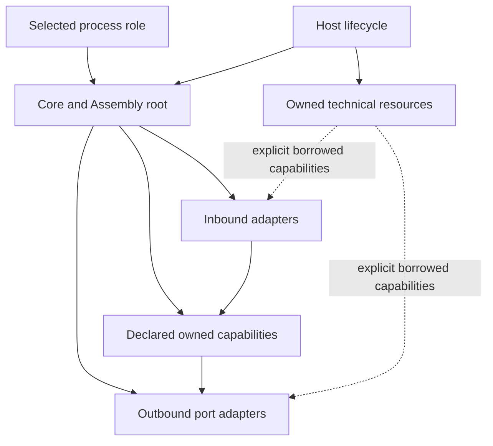

# Composition and Dependency Injection

## Purpose

Composition connects typed feature capabilities to concrete adapters without
exposing the construction mechanism to business code. Semantic ownership,
workspace packages, feature groups, composition entries, and deployed services
are distinct boundaries. Their sizes do not have to match.

## Get Modular adoption profile

ADR-0113 selects the exact static Get Modular baseline. ADR-0117 reconciles the
broader mandatory scope and foundation requirement from the parallel owner
work without changing that baseline. The historical ADR-0110 pin is superseded;
Awilix and competing handwritten production assembly remain prohibited.
The following is the local Consumer Module Standard adoption profile; the
[feature profile](feature-module-standard.md) separately owns FMS v1.1.

| Profile field | Selected value |
|---|---|
| Standard repository | `agent-teams-ai/get-modular` |
| Standard path and anchor | `docs/architecture/common-assembly.md#consumer-module-standard` |
| Immutable commit | `a3a079baca2c6af48c9d45bc08992825be1c2bbd` |
| SHA-256 of complete document | `e5cb510c5ea83e54a6833cc40b6ad31fc5cf8c70d9838e4e0c6923edc6f70919` |
| Core and Assembly | `@get-modular/core@0.5.0`, `@get-modular/assembly@0.5.0`, exact pair |
| Accepting decision | `ADR-0113` for the exact baseline; `ADR-0117` for reconciled scope and foundation |
| Production scope | Applicable independently assembled TypeScript capabilities under `apps/**` and `packages/**`; each actual composition surface is inventoried before activation |
| Composition owner | One selected Host process role, with context-owned entries and curated context handles |
| Lifecycle owner | Each Host for its application resources; Local Supervisor or hosted platform for component availability |
| Legacy boundary | Historical Awilix ADR only; no parallel production container or direct assembly fallback |
| Exceptions | None declared |
| Current implementation status | Selected architecture; production materialization and first-scope conformance remain gated |

The immutable [upstream standard](https://github.com/agent-teams-ai/get-modular/blob/a3a079baca2c6af48c9d45bc08992825be1c2bbd/docs/architecture/common-assembly.md#consumer-module-standard)
owns the exact authoring rules. Every applicable production composition seam
uses Get Modular, including meaningful platform, integration, SDK, contract,
and testing-package assembly, not only Host/context package families. Pure
contracts, private helpers, parsers, mappers, and fixed library dependencies
remain ordinary typed code. Owner-local factories implement capabilities; they
are not an alternative production graph. Library composition exposes a narrow
API without leaking framework descriptors into consumer business code.

Use the existing Resources capability when an adopted module acquires resources,
after selecting and qualifying an exact compatible artifact with this baseline.
The requirement does not install an unreviewed Resources or Observation version.
Pure and borrow-only modules do not require resource scopes. Any additional
package requires concrete integration need and exact dependency qualification;
a competing resource or lifecycle framework is not the fallback. The upstream conformance
kit is required development tooling for the first activated production scope;
it is not another runtime subsystem. Core and Assembly adoption does not activate
runtime plugin discovery or hot replacement.
The existing extension safety and artifact-admission contracts still apply.

## Runtime topology



Each declared Host process role has one production composition authority. It
selects bindings once, constructs its declared capabilities once, and retains
the closed root handles. The [service role map](deployment-profiles.md#service-role-map)
owns process placement under ADR-0114; this diagram describes construction
inside one role. Context-internal capabilities remain private. Other contexts
receive only a declared Published API through their consumer-owned adapters. No
context inspects another context's registrations, implementation instances, or
internal graph.

A separately running Host constructs only its own declared profile; it does not
reconstruct a remote owner's capabilities as an in-process fallback. Agent,
tenant, project, team, task, run, and session identities do not create extra graphs,
brokers, containers, database clusters, or processes.

## Physical placement

The pinned standard maps a feature's composition to flat files:

```text
apps/<host>/src/composition/
  <profile>.root.ts
  <owned-input>.contracts.ts
  <owned-input>.declaration.ts
  <owned-input>.module.ts

packages/contexts/<context>/src/
  composition/
    create-context-handle.ts
  features/<feature>/
    domain/
    application/use-cases/
    application/ports/
    adapters/
    composition/
      <feature>.contracts.ts
      <implementation>.declaration.ts
      <implementation>.module.ts
      <feature>.group.ts
    features/<child>/
      composition/
        <child>.group.ts
```

This is an ownership map, not a scaffold. Directories and composition contracts
appear only with real adopted constructs and their enforcement. The feature
profile currently rejects activation of new nested constructs until its scoped
checker supports them. A Host root may import only curated composition exports;
it never deep-imports a context's feature implementation.

Descriptors carry stable capability identities and revisions. Declarations use
`declareModule` and the selected contract descriptors. `implement` and `input`
produce entries, `group` gives a static navigable grouping, and the root lists
entries and groups in `prepare({ modules })`. Do not reproduce wire-generation
literals, compatibility tokens, or registry lookup in business code.

A parent group owns its own entries and the groups of its direct children. A
root lists top-level groups, Host-level groups, and its own entries. It cannot
assemble a private descendant through an alternate path. Group membership is
static; a deployment variant has its own explicit root and profile identity.
An entry must not be listed twice or depend on registration order.

A composition descriptor at `composition/<feature>.contracts.ts` is not an
application port or a public wire message. Get Modular capability revisions
change with the descriptor value type under its own compatibility rules;
Protobuf, event schema, and SDK evolution remain independent contracts.

## Construction contract

Get Modular imports and types stay in composition and tests. Feature factories
accept narrow dependency records and return narrow APIs. Application and domain
code use only their owned ports and models, never a descriptor, resolver, broker,
SDK DTO, or container abstraction. Port members use function-typed properties,
not method signatures that hide parameter variance.

Prepare and declaration evaluation are free of external effects. Graph errors
must fail before capability factories run. Ordinary factories build passive
components; external startup happens in explicit Host lifecycle steps. Async
construction, where required, retains an explicit owner for every acquired
resource and every returned product until custody is transferred or cleaned up.
No effect may escape a failed construction attempt.

Prohibited mechanisms include:

- filesystem scanning, reflection, decorators, or implicit registration order;
- mutable singleton registration or string lookup from business code;
- a generic `ContainerPort`, `ServiceLocator`, or arbitrary capability registry;
- a second Awilix or direct-factory production graph for the same capabilities;
- constructing the feature graph again inside a gRPC handler or service adapter;
- acquiring runtime execution authority through module registration;
- using `any`, broad casts, or a double assertion through `unknown` to hide a
  binding, capability, or lifetime mismatch.

Get Modular isolates construction; it is not wrapped in a second general-purpose
DI framework. The Clean Architecture boundary is the owned application port.

## Lifetimes and scopes

Constructed context capabilities normally live for the Host process lifetime.
An explicit operation scope is created when a command, query, event delivery, or
Temporal activity needs Unit of Work, authenticated facts, trace context, or
request-local idempotency handling. Its factory and cleanup remain private to
the owning context adapter and lifecycle.

A longer-lived capability cannot retain an operation-scoped dependency. The
operation scope is disposed in `finally` after commit, rollback, and post-commit
intent handling reach their defined boundary. Do not keep a SQL transaction open
for an RPC call, model response, user approval, or durable workflow wait.

Inbound adapters receive already-constructed capability handles from the Host.
A GraphQL request may own bounded loaders and authenticated request resources;
it does not construct another feature graph or hold one SQL transaction across
resolvers. Each command or query retains its owning operation scope. Request
caches cannot outlive their authenticated scope or be retained by singleton
capabilities. Framework contexts are mapped to the narrow application invocation
profile before calling the input port.

## Lifecycle

The Host owns bootstrap order, readiness, health aggregation, process signals,
and ordered shutdown. Contexts borrow only explicitly listed technical
capabilities and never dispose Host-owned resources. A module declaration is not
permission to own an operating-system process.

Startup follows the declared dependency order; shutdown is bounded, idempotent,
and in reverse dependency order. Stop admission and consumers, drain bounded
work, reconcile or preserve durable dispatch intent, close context-owned
resources, and then close shared resources. Do not infer this ordering from a
container or a broker's global exit hook.

The Local Supervisor separately owns the availability and activation of local
Host roles, Dapr sidecars, PostgreSQL, and NATS components. Host adapters own
protocol connections and behavior, not a competing process lifecycle. Hosted
component supervision belongs to the deployment platform. Dapr service readiness
and Host application readiness are explicit observations; neither transfers
business ownership or qualifies the other component automatically.

A graph or Host restart has no business meaning. Tasks, runs, operations, inboxes,
outboxes, and dispatchers recover from their owning durable contracts.

## Context handle

Context bootstrap returns a narrow opaque handle conceptually shaped as:

```ts
interface ContextHandle<TPublishedApi> {
  readonly api: TPublishedApi;
  readonly start: () => Promise<void>;
  readonly health: () => Promise<ContextHealth>;
  readonly stop: () => Promise<void>;
}
```

The composition-owned real type exposes no Core, Assembly, Dapr, gRPC, or database
implementation type. Internal factories, repositories, operation-scope creation,
and graph inspection remain private.

## Cross-context collaboration and service boundaries

A consuming context receives an adapter implementing its consumer-owned port.
That adapter calls the provider's Published API or versioned transport contract.
Integration events remain the preferred mechanism where synchronous
collaboration is not required. Synchronous dependencies form an acyclic graph;
cycles require corrected ownership, events, or an owning process manager.

Before materializing a declared service role, name its owning capability,
selected placement, contract and wire protocol, state and transaction owner,
durability, authorization, concurrency and recovery semantics, lifecycle owner,
and resource budgets. Record these in the owning feature/context and accepted
deployment profile. A new role beyond the accepted map requires a concrete
scaling or isolation reason and an accepted deployment decision; file size,
feature count, or an entity count does not create another service.

[ADR-0114](../decisions/0114-canonical-backend-stack-and-distributed-role-adoption.md) selects
feature-owned Protobuf and standard gRPC through Dapr at real private RPC
boundaries. Apply the process separation from first production materialization.
Control Host reaches Team Topology S3 through its consumer-owned port and ACL in
a separate process through Dapr; an in-process router cannot satisfy that
boundary. Each process assembles its capabilities once, and adapters invoke the
resulting handles. Ordinary collaboration within a role remains typed and local.

The public Connect API, direct JetStream durable handlers, AR execution ownership,
and Host construction retain their existing contracts. Moleculer is not selected
as an additional private RPC layer. Dapr invocation does not adopt Dapr state,
pub/sub, actors, or workflows. Exact dependency and deployment qualification
remains separate from these architecture selections.

## Profiles, verification, and replacement

Local and server profiles assemble the same application capabilities with their
explicit adapter and deployment configuration. Business unit tests use direct
factories and fakes, not a production graph. An in-process test implementation
never becomes an undeclared production fallback.

The upstream authoring budgets are stricter within an adopted Get Modular
feature: 300 effective lines per non-test file, 60 per function, 4 parameters,
and 80 effective lines per module wiring file. Other existing repository budgets
remain in force. Do not enlarge a budget to accommodate generated wiring.

Current `architecture:feature-module-profile` and the quality topology check in
`foundation:check` bind adoption and the construct activation boundary. They do not prove
Get Modular graph or nested-source semantic conformance. Before the first
production scope materializes, pin a compatible `@get-modular/conformance`
development dependency and connect the standard's checks to the existing
Foundation execution gate with declared test identities: `checkModuleLayout`,
`checkNamespaces`, `isolate`, `smoke`, and an independent binding oracle checked
by `checkWiring`. A capability with two implementations, including its fake,
also requires the owner's `contractSuite` and `runContractSuite`.
Cover rejected duplicate entries, invalid bindings, forbidden imports, illegal
nested visibility, cleanup on construction failure, scope disposal, and ordered
shutdown, alongside a valid representative Host graph. Runner integration belongs
to that materialization change; replacing the standard's required checks needs
an explicit accepted exception rather than a weaker local substitute.

Use `pnpm check:changed` during iteration, `pnpm check:fast` for handoff, and the
complete `pnpm check` before a pull request. Passing document checks or installing
0.5.0 does not qualify a running Host or distributed deployment.

Replacing Core/Assembly changes composition and its conformance evidence. It
must not require changes to domain behavior, application ports, public contracts,
or persistence authority.

## Commands, hooks, state, and durable events

Choose communication by the guarantee the consumer needs:

| Need | Mechanism and owner |
|---|---|
| Request an operation and receive a typed result | Consumer-owned command/query port, selected through a slot |
| Select a policy or contribute ordered behavior | Explicit required/optional/many capability contracts, with owner-defined order and failure semantics |
| Observe replaceable latest state | Get Modular Observation, with one writer and subscriber-owned lifetime |
| Call a remote service | Published Protobuf contract and selected transport adapter |
| Preserve every committed occurrence | Feature-owned durable event or operation contract, outbox/inbox and reliable adapter |
| Recover a long-lived business process | Owning process manager and selected durable scheduling adapter |

A hook is an explicit capability with a purpose, owner, order, failure result,
and permission boundary. It is not an unrestricted global callback registry.
Authorization and business invariants cannot be delegated to optional notification
hooks.

Observation `watch` and `load` may coalesce changes and operate on latest state.
They are appropriate for replaceable state or an invalidation hint that causes a
read of authoritative state. They cannot be the sole source for incremental
durable projections, Work dispatch, billing, audit, or access revocation.
A durable subscriber may publish its resulting current state into Observation
after its durable checkpoint commits.

This is a deliberate semantic distinction, not a requirement to add durable
delivery to Observation. Browser use needs its own qualification; Node behavior
does not prove browser parity.

## Shared mechanisms and independent products

Orchestrator owns Team, Work, Task, assignment, Run, project-owned Execution
Directory registration/materialization, and orchestration placement/binding
intent. Agent Runtime owns actual execution, sandbox, and process resources
under the [runtime boundary](runtime-boundary.md). Platform invokes Orchestrator
capabilities through the public API/SDK and versioned managed lifecycle/authority
contracts. It does not implement a second task engine or write Orchestrator
storage.

Platform retains its own customer, commercial, product-project, admission, and
deployment policy. Its product authority adapter is one selected deployment
integration. Standalone Self-Hosted selects its independent authority and must
operate without a Platform endpoint or private package registry.

The [companion Platform proposal in PR #55](https://github.com/agent-teams-ai/agent-teams-platform/blob/a4d47e1c27c3c1efc0e94f770fc9064b0bc17bfc/docs/architecture/platform-orchestrator-boundary.md)
records the hosted product relationship and proposed exact integration contracts.
The link pins the reviewed proposal, not merged Platform authority. Each product
can release independently; a managed composition binds compatible contract and
capability versions explicitly. A shared mechanism must not force standalone
Orchestrator to deploy Platform or update both products together.
[The research coverage](../research/collaboration-hierarchy-and-workspace-review-2026-10-22.md)
records the evidence, pending Platform adoption, and remaining product choices.

Reusable libraries may own concrete mechanisms shared by real consumers: OIDC
validation, provider administration adapters, the selected relationship-
authorization client and its conformance suite, transport primitives, and Get
Modular itself. OpenFGA remains the candidate described in
[OD-012](../open-decisions/OD-012-identity-authorization-tenant-isolation.md); this composition
contract neither selects the IAM stack nor requires speculative package
extraction. Product permission names, role policy, membership lifecycle, domain
aggregates, repositories, and transactions remain with their owners. Similar
fields do not justify a shared `Tenant`, `Project`, `Principal`, or `Task` domain
package.

For a concrete mechanism already expected to serve both products, follow the
organization's [library-first rule](https://github.com/agent-teams-ai/.github/blob/main/docs/engineering-quality-standard.md#library-first-design-and-deliberate-evolution):
design one reusable library and contract from the start, and validate it with
disposable consumers and at least one real consumer in the same delivery.
Do not first duplicate the mechanism in both products while waiting for a
second implementation. This does not authorize speculative packages, a shared
business domain, or a universal IAM framework; the named owners and actual
repeated need still determine the boundary.

A shared provider adapter does not imply one remotely mandatory authorization
service. Each product/process supplies its own policy through narrow ports and
uses explicitly versioned contracts. This avoids both copied provider plumbing
and a distributed application that can only change all services together.

## Activation and existing implementation

ADR-0117 preserves the mandatory framework choice. Production activation is pending
the [module foundation gate](implementation-readiness-gates.md#module-foundation-before-business-expansion).
The exact Core/Assembly baseline is selected by ADR-0113, but not installed by this reconciliation; no
runtime, scale, browser, or complete source conformance is claimed.

At reviewed main `98f653172215e2a2c73cc484db3fa4fe72ed21ba`, the materialized
`agent-context/sandbox-manifest/composition/feature-module-factory.ts` remains a
known migration seam. `packages/platform/local-host-control` also requires
classification of actual independently assembled seams; pure utilities do not
automatically need entries. New source from concurrent materialization must be
included in the same inventory before activation. Neither package receives an
implicit permanent exemption.

Required consumer evidence includes:

- source inventory and exact adoption scope with no second production resolver;
- complete nested visibility, direct-parent assembly, republication, and cycle
  checks from the existing source classifier;
- `isolate`, per-root `smoke`, an independent `checkWiring` oracle,
  `checkNamespaces`, and `checkModuleLayout` integration;
- contract suites for alternative implementations, including fakes;
- preparation failure with zero factory calls, attempt isolation, cancellation,
  startup failure, and resource handoff/cleanup;
- supported-toolchain growth and exact packed-artifact tests.

`checkModuleLayout` validates supplied source facts; it is not an import parser.
Foundation remains the source/dependency policy engine. A second handwritten
parser or module framework is not the migration plan.
