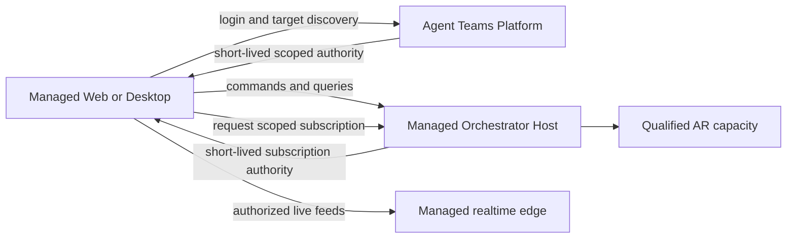

# Deployment Profiles

## Independent axes

Deployment authority, client, execution placement, and packaging are separate
choices:

```text
Orchestrator deployment profile
  Managed SaaS | Standalone Self-Hosted | future Connected | Fully Local

Client surface
  Web | Desktop | CLI | SDK consumer

Agent execution placement
  local device | customer worker | managed remote worker

Deployment form
  server Docker Compose | server Kubernetes | native local components
```

No axis is inferred from another. Desktop is not automatically local authority,
Web is not automatically managed, and local AR execution does not mean that
orchestration state is local.

## Profile matrix

| Profile | Orchestrator authority | Product authority | Persistence | V1 | Clients |
|---|---|---|---|---|---|
| Managed SaaS | Agent Teams-managed Server Host | Managed Platform authority adapter | Managed PostgreSQL and server infrastructure | V1 target, qualification blocked | Managed Web, Desktop, CLI, SDK |
| Standalone Self-Hosted Server | Customer-operated Server Host | Standalone authority adapter | Customer PostgreSQL and server infrastructure | V1 target, qualification blocked | Co-deployed Web, Desktop, CLI, SDK |
| Connected Self-Hosted Server | Customer-operated Server Host | Standalone authority plus optional managed capabilities | Customer PostgreSQL and server infrastructure | Future, qualification deferred | Co-deployed Web, Desktop, CLI, SDK |
| Fully Local Desktop | Local Host on user device | Local standalone authority adapter | Bundled native PostgreSQL with context-owned schemas and protected local components | V1 target, qualification blocked | Desktop, local CLI, SDK |

Managed, Self-Hosted, and Fully Local use the same logical Orchestrator core and
public contracts. Context-owned use cases, PostgreSQL adapters and migrations,
and applicable business conformance are reused. Composition selects authority,
infrastructure, and lifecycle adapters and validates one complete compatible set.
A profile name never appears as a business-rule branch. The
[shared-profile decision](../decisions/0112-fully-local-v1-with-shared-backend-profiles.md)
defines the DRY boundary without combining native supervision with server
orchestration or merging Platform, Orchestrator, and AR ownership.

The reliability catalog is the machine-readable profile registry. `V1 target`
does not mean `qualified`: Managed, Standalone, and Fully Local remain blocked by
their listed decisions and capability evidence. ADR-0112 requires all three for
V1 while retaining separate implementation-start gates. Connected Self-Hosted is a fourth
future profile in that registry even though it is not a V1 target.

Each profile binds exactly one product-authority adapter and an independent
commercial-authority mode. Managed Product Authority, Standalone Authority, and
Commercial Access Authority are separate logical ports even when one Platform
deployment implements more than one. Managed commercial access is optional and
qualified as a separate capability, so OD-037 cannot block baseline Managed SaaS.

Qualification is closed over mandatory capabilities. Managed and Standalone
require qualified `server-runtime-execution`; Fully Local requires qualified
`local-host-runtime-execution`. Optional `local-device-execution` and
`managed-commercial-entitlements` cannot be advertised until independently
qualified. The global qualification framework remains blocked by OD-039; an
accepted ADR plus an arbitrary file is not evidence.

## Concurrent execution target

The server architecture targets one agent team through enterprise workloads
with thousands of simultaneously running agents and several concurrent users
and clients. Running means current admitted execution evidenced by AR's
Published Language. Stored Agent definitions, idle sessions, registered workers,
queued work, and open browser connections do not establish that concurrency.

The primary scaling and release-qualification target is aggregate admitted
execution across many independent Runs, including Runs within one team and
tenant. Per-Run capacity is qualified and advertised separately; thousands of
agents within a single Run are not a baseline release requirement. Qualification
still exercises the largest advertised Run and concentrated tenant load.

Concurrent Runs retain the exclusive active Agent occupancy required by
[ADR-0101](../decisions/0101-run-specific-rosters-coordination-and-exclusive-agent-occupancy.md)
and use separately eligible participants. Do not split one semantic Run merely
to meet a throughput target or weaken receipts, fences, ordering, cancellation,
or revocation to increase the reported capacity.

Each advertised capacity names an exact concurrent workload, active Run and
participant shape, command and observation rates, output bytes, bursts,
payloads, fanout, stored data, duration, hardware, failure conditions, and
deployment composition. The target is not a measured result or an approved SLO.
The [testing strategy](testing-strategy.md#concurrent-execution-and-service-role-qualification)
separates modeled Orchestrator load from AR and provider execution evidence.

Scale role replicas, bounded durable handlers, data infrastructure, and AR
execution capacity. Do not allocate an Orchestrator process, sidecar, SQL pool,
database cluster, or logical durable subscription per agent. Low-end profiles
declare their own smaller resource envelope; a desktop device is not required
to execute the enterprise workload.

## Service role map

This is the canonical process-placement map under ADR-0109. The
[context map](context-map.md) owns semantic boundaries and their acceptance
status; placement does not accept an unresolved domain model. A role is an
independently runnable, restartable, and resource-bounded process. A Host is a
composition and lifecycle owner inside that process, not a physical machine.

The table defines nine coarse application roles, not a required fixed service
count or a fleet of empty packages. Each isolated role appears with its first
owning feature after the existing domain and package admission gates pass.
Two application processes describe the initial S3 Topology integration only;
the first durable orchestration, observation, or effectful slice must introduce
its applicable roles in that same change. Replicas and future role splits are
separate deployment decisions.

| Role | Semantic owners and capability scope | Required process boundary from first delivered feature | Communication |
|---|---|---|---|
| Control Host | Public API and lightweight interactive handlers: Orchestration Scope, Agent Organization, Work Coordination, Policy and Risk, Approval Management, Consumption Governance, and the interactive handlers of contexts with worker roles below. Identity Registry and Access Control remain provider-facing authority seams under OD-012 | Separate from AR, background coordination, heavy intake/compute, workspace mechanics, and external delivery. It never constructs the private Team or Observation query implementation as a fallback | Public Connect; typed local ports and ACLs; Dapr for actual private RPC dependencies |
| Team Topology service | Team Topology's Agent/Team definitions and versioned roster; initially only S3 persistent Team create/get/list | Separate from Control Host from S3. Commands and queries can share this role; assignment uniqueness, immutable history, receipts, and outbox retain one owned transaction | Feature-owned Protobuf and standard gRPC through Dapr; owned outbox through JetStream |
| Coordination worker | Run Orchestration processes; Orchestration Scope disposition/reconciliation; Work Coordination processes; Agent Communication delivery policy; Agent Attention decisions; Approval Management expiry/revocation reconciliation; Consumption Governance reservation expiry, period rollover, and reconciliation | Separate from Control Host from the first durable coordination feature. Owners may share the role with independent handlers and budgets. Cutoff, revocation, cancellation, and recovery retain reserved progress under ordinary delivery backlog | Direct JetStream or selected workflow Activity adapters to owned ports; consumer-owned AR ACL; Dapr only for an actual private RPC dependency such as Team activation |
| Observation ingestion worker | Execution Observation admission, receipts/checkpoints, evidence, safe activity, feed, and required downstream intents | Separate from Control, query, and derived workloads from first runtime evidence intake. Its atomic admission transaction is not split between services | Qualified AR source adapter and applicable durable consumers; indexing/publication follow committed owner intents |
| Observation query service | Execution Observation authorized snapshots, timeline, feed resume, search, diagnostics, and selected export control | Separate from intake and index/rebuild work from first query feature. Query disclosure and availability do not depend on indexing being healthy | Private query/control port through Dapr; only owned stores and published dependencies |
| Derived-data worker | Execution Observation indexing/rebuild; independent Usage Metering source admission/checkpoints, quarantine, normalization/correction; Usage Accounting rating/reconciliation handlers | Separate from Control, Execution Observation intake, and interactive queries from the first owning feature. Shared placement creates no shared analytics model, transaction, or storage authority | Direct durable handlers and owner-specific outbox/source ports; no incidental RPC hop |
| Agent Context worker/service | Agent Context contribution admission, semantic assembly, manifests, validity, invalidation, and continuity evidence | Separate compute role from its first assembly feature. Assembly stays durable and bounded; it does not become a synchronous call chain through all source owners | Durable intake and assembly; Dapr only for declared private queries/control. Run owns activation and AR owns technical materialization |
| Workspace mechanics worker | Workspace Registry materialization/release/cleanup through worktree, clone, snapshot, and remote-workspace adapters; registry control may remain in Control Host | Separate from Control from first effectful materialization. Machine/resource affinity, privileges, allocation/binding generations, and cleanup custody constrain placement | Resource-affine durable dispatch through the owned port; Dapr only for an explicitly selected request/reply boundary |
| Outbound-effects worker | Human Notification Management delivery attempts and reconciliation; other accepted external-effect adapters only with distinct owners and budgets | Separate from Control from first external delivery. Secrets, quotas, attempts, idempotency, and uncertain outcomes remain owner-specific | Direct durable consumers and controlled egress; no RPC registration solely because it is a worker |

The map accounts for all 18 strategic contexts without making each a separate
microservice. Interactive and background handlers of one context share that
context's authority and concurrency rules, not a process-local authoritative
cache. A role containing several contexts receives only their explicitly owned
capabilities and scoped credentials; it has no cross-context Unit of Work or
unrestricted access to other owners' tables.

Placement covers background lifecycle work as well as interactive APIs. The
Approval and Consumption Governance entries place their future admitted durable
handlers; they do not resolve those contexts' open domain decisions or require
their implementation in S3. Each first-materialization record also places the
owner's outbox relay, expiry, reconciliation, and disposition handlers where
applicable. A context name in the Control row alone does not place that work.
Shared queues, separate consumers, or separate SQL pools cannot by themselves
prove CPU, event-loop, memory, or failure isolation inside a shared process.
Usage Metering retains its own source receipts and checkpoints; Execution
Observation intake does not become its ingestion authority. Before admitting
that workload, demonstrate that normalization or rebuild cannot prevent bounded
usage admission and recovery, or select the required further role separation.

Scope, Run, and Execution Observation keep their independent AR subscriptions,
receipts, and checkpoints. The Observation role does not become the universal
runtime-event authority. Replicas of one semantic JetStream subscription share
its logical durable consumer; different subscribers retain independent delivery.
An AR source subscription is not automatically a JetStream subscription.

Workspace dispatch preserves persisted machine/resource affinity and current
allocation and binding generations. A timeout cannot authorize another worker
to repeat an uncertain effect under a fresh identity. A stale cleanup cannot
delete a successor allocation. Ordinary Dapr replica balancing is insufficient
to establish resource access or transfer custody.

AR remains an external execution deployment with its own capacity, provider
sessions, execution attempts, permissions, and private fences. PostgreSQL,
JetStream, Centrifugo, selected workflow infrastructure, the authority provider,
and the Local Supervisor remain separate infrastructure/lifecycle boundaries.
They are not additional business contexts and do not receive Dapr sidecars
merely because they are dependencies.

Review Management and Automation and Scheduling remain candidates under OD-027;
external integration management remains deferred under ADR-0074 and OD-034.
Their future admission must choose placement through this same process; the
map creates no placeholder service, contract, package, or release commitment.

### Further separation and replica rules

Permitted co-location is evaluated before each owning feature ships and before
increasing its qualified workload. Separate another role when a distinct trust
boundary, secret/egress permission set, machine affinity, implementation
language, rollout lifecycle, or resource profile is required, or when shared
placement cannot preserve neighboring control and recovery budgets. A trigger
must be resolved by a recorded role change or a bounded demonstrated composition;
it cannot be postponed behind an unspecified later performance project.

Each selected private RPC role uses standard gRPC through Dapr under ADR-0105.
Only interchangeable instances with the same method set, semantics, and trust
scope share a route identity. Command and query roles with different methods
need separate identities or a qualified method-routing ingress. A group may
therefore contain multiple services; a role may contain multiple compatible
groups. Neither relation changes semantic ownership.

Route qualification covers the complete configured namespace and application
identity on the actual invocation path. A profile that reuses application IDs
across namespaces must prove that a requested remote namespace cannot collapse
to the caller's local application. An unsupported routing combination is
rejected explicitly; generic namespace support does not qualify every proxy
path or authorize a cross-Target route.

One semantic mutation owner may have several qualified write replicas. Database
constraints, revisions, receipts, claims, and fencing protect its invariants.
One operation's atomic state and intents remain in one owned transaction; no
SQL transaction stays open across an RPC. Shared owner schemas require one
migration authority and a qualified mixed-version rollout.

## Deployment forms

Both Docker Compose and Kubernetes are required server deployment targets.
Compose is the default server development and small-server composition;
Kubernetes is the large-cloud composition. They package the same selected
roles and contracts without creating new business authority profiles. Neither
form is currently qualified by this documentation change.

| Concern | Desktop with hosted Target | Fully Local V1 Target | Server Compose | Server Kubernetes |
|---|---|---|---|---|
| State authority | Selected remote Target | One explicit local Target | Selected server Target | Selected server Target |
| Component availability | Remote platform; Desktop is a client | Local Supervisor | Container platform/operator | Kubernetes workload controllers |
| Role placement | At the selected server | Native processes for selected local capabilities | Separate role containers/processes | Separate role workloads and replicas |
| Dapr placement | None on the client merely for using Desktop | Paired native `daprd` for each RPC-participating Host instance | Explicit app/sidecar pair per participating replica | Paired sidecar in each participating role pod |
| Durable-only worker | Server concern | Direct JetStream; no sidecar without RPC need | Same direct adapter | Same direct adapter |
| PostgreSQL/NATS | No direct client database access or unused local infrastructure | Bundled native components under Supervisor | Declared server data infrastructure | Declared server data infrastructure |
| Discovery and trust | Client validates remote Target | Qualified protected local discovery and peer identity | Qualified resolver, private network, identity, and replica pairing | Qualified Kubernetes resolver, service identity, network policy, and rollout |
| Capacity evidence | Remote profile plus client experience | Local supported hardware and workload | Actual Compose composition and declared replica envelope | Actual Kubernetes composition, replica envelope, and scaling controller |

Each first materialized server role supplies both deployment mappings and their
mandatory executable integration lanes. Static configuration checks and real
environment execution are different evidence. Fast tests can omit infrastructure;
the default server integration profile and required boundary CI cannot replace
Dapr with a hidden in-process route. Any advertised form must pass its actual
startup, failure, drain, recovery, and resource suites before release.

The supported Compose release provides one documented launch command after
explicit configuration and secret provisioning. It starts only selected
components and reports readiness or actionable failure. Startup speed is
measured, not guaranteed by `depends_on`. App and Dapr use separate production
containers. Scaling a Compose service must preserve correct app/sidecar pairing;
the configuration for one pair is not evidence for multiple pairs.

Kubernetes supplies workload placement and replica management; an approved
controller policy binds scaling to measured demand and bounded resources.
HPA or another controller does not replace application admission, tenant
fairness, SQL connection budgets, or AR capacity limits. Aggregate budgets cover
all simultaneously live instances, including rolling-update surge, terminating
instances that still hold resources, and overlapping rollouts. A readiness
change does not prove that a draining instance has closed its SQL pools.

Self-hosted Dapr discovery is explicitly qualified on the real native or
container network. Compose DNS alone is not a Dapr resolver, and multicast
availability is not assumed. Select exact resolver, peer trust, certificates,
rotation, protected application hops, and direct-backend access policy before
profile activation. Dapr peer authentication never replaces product grants.
Workload enrollment must authenticate which process may obtain each service
identity; enabling mTLS and invocation ACLs alone does not establish that right.
The [private RPC trust profile](security-architecture.md#private-rpc-trust)
owns this distinction and the two protected application/sidecar hops.
OD-012 and the local lifecycle decisions retain their relevant authority.

The native V1 reference profile preserves the selected role isolation.
Only implemented and advertised local capabilities are bundled. A smaller
local workload does not silently permit co-location: a compact profile needs
an explicit placement decision and independent failure/resource qualification.
It cannot collapse AR custody, privileged workspace effects, semantic owners,
or Target authority. Fully Local is a required V1 target under ADR-0112; OD-040
still gates implementation start and the profile remains unqualified.

Official [Dapr Docker hosting](https://docs.dapr.io/operations/hosting/self-hosted/self-hosted-with-docker/),
[Kubernetes integration](https://docs.dapr.io/operations/hosting/kubernetes/kubernetes-overview/),
and [resolver reference](https://docs.dapr.io/reference/components-reference/supported-name-resolution/)
describe the mechanisms. They do not qualify an Orchestrator release composition.

## First-materialization placement record

The first PR implementing a role or extending its handler set must update the
owning feature record and executable composition together. Record:

1. semantic owner, implemented capabilities, real consumers, and local, RPC, or
   durable-delivery semantics;
2. role process and Host root, route/replica contract, per-profile mapping,
   lifecycle owner, and explicitly unsupported profiles;
3. owned schema, migrations, transaction and receipt boundary, versioned wire
   contract where applicable, and mixed-version compatibility;
4. trusted invocation scope, authorization, secrets/egress, affinity or custody,
   and any scoped claim/fence required by the operation;
5. bounded admission, handlers, queues, database pools, replica/surge limits,
   readiness, drain, and uncertain-outcome recovery;
6. required source and process checks with rejecting fixtures, exact CI runner
   registration, and environment evidence for claims being made.

Control Host composition must reject registration of handlers assigned to a
separate workload role. Runtime adapters invoke already-constructed handles and
do not rebuild remote-owned application graphs. These are mandatory obligations
for first implementation; current documentation validation does not establish
that the source/process enforcement has been implemented. See the
[readiness gates](implementation-readiness-gates.md#first-materialization-role-gate).

## Managed SaaS topology

Managed SaaS means that an Orchestrator Host is running in Agent Teams-managed
infrastructure. The architecture permits local or remote agent execution, but a
placement is advertised only after its own connectivity conformance passes.



Platform is the managed product authority and control plane for customer
identity, tenancy, membership and grants, product-project binding, optional
commercial access, managed deployment placement, and target discovery. It does not own
Orchestrator Runs, Teams, Work, messages, Observation Evidence, Activity Views,
or diagnostic payload.

The normal data path does not proxy through Platform. After bootstrap, clients
connect directly to the scoped Orchestrator and realtime edge. Direct transport
does not bypass authority: the Host validates Platform-issued, audience-bound,
short-lived authority and current revocation requirements. Exact commercial
capability semantics remain open under OD-037.

Local-device execution behind a server Host is a separately gated deployment
capability, not a blocker for a server profile that has independently qualified
remote capacity.
OD-038 owns device enrollment, outbound connectivity, revocation, reconnect, and
custody. Until it passes, server profiles advertise only runtime placements whose
connectivity has independent qualification evidence.

## Standalone Self-Hosted topology

The customer deploys the Server Host, PostgreSQL, broker and realtime adapters,
and the Web UI from one supported release composition. A Standalone Authority
adapter replaces Platform identity and grant dependencies for baseline operation.

Self-hosted operation does not require Agent Teams-managed APIs, private package
registry access, or an active commercial connection unless the customer
explicitly enables a future connected managed capability.

The co-deployed Web UI uses the same origin or a release-qualified reverse-proxy
topology. Desktop can store an explicit named Target Profile for the server after
discovery, TLS, protocol, authority, and capability validation.

Desktop connects through the ordinary SDK and authorized feeds, never directly
to PostgreSQL. Selecting a server Target does not start unused local databases,
create a local business write model, or enable automatic synchronization. A
failed remote request is not retried against a local Host.

## Fully Local V1 topology

Fully Local composes the Local Host, shared context-owned PostgreSQL
adapters, a bundled native PostgreSQL cluster, local workflow adapter, local
realtime edge, and AR execution components under the Local Supervisor. One
Target data root persists across component versions and is shared by clients;
there is no database per client, project, or agent. Components are independently
signed and lifecycle-managed; unused local infrastructure is not started merely
because Desktop is installed.

ADR-0106 selects the database strategy; ADR-0108 selects `embedded-postgres`
behind the Supervisor component adapter. Neither selects a Desktop framework or
qualifies an exact launcher dependency. The [packaged PostgreSQL matrix](local-host-lifecycle.md#packaged-postgresql-qualification)
requires evidence for each released platform and capability, including actual
restore. ADR-0112 requires this profile in V1, while OD-040 remains the separate
package-materialization gate. OD-035
names OpenWorkflow as the preferred local workflow spike candidate, now requiring
its PostgreSQL backend. Engine selection cannot change public resource, persistence port,
workflow-state, feed, recovery, or authority boundaries.

Baseline local orchestration has no required Agent Teams cloud account, Platform
runtime, or managed commercial connection. External provider capabilities retain
their declared network requirements. Local selection does not promise offline
inference from every provider, or enable automatic local/cloud synchronization.

## Connected and hybrid evolution

A customer-operated or Local Host may later consume selected managed
identity, commercial, update, relay, or collaboration services while retaining
local orchestration state. That is a separate Connected Self-Hosted or Connected
Local profile, not Managed SaaS and not an implicit fallback.

Such a profile requires explicit data-flow, offline, revocation, licensing,
privacy, recovery, and degraded-mode decisions. It cannot be created merely by
letting a local Host call arbitrary Platform endpoints.

The baseline Standalone profile remains usable without Platform. A connected
commercial adapter may add selected capabilities, but lease expiry cannot block
cancellation, containment, recovery, deletion, or baseline access and export of
customer-owned data.

## Client Target Profiles

A Client Profile owns user-facing connection selection, not server state. It
contains safe target metadata and opaque credential references:

```text
profileId
displayName
targetId
targetKind
endpoint and discovery identity
authorityRealmRef
trustConfigurationRef
credentialRef
lastValidatedProtocol
lastKnownCapabilities
```

Target metadata cannot grant authorization. Secrets are resolved by the client
credential adapter. Capability snapshots are presentation hints and are
revalidated by the Host before commands.

Every client resource reference combines `TargetIdentity` with the public
resource reference. The active profile also owns a monotonically changing local
client generation. Switching profiles retires the old generation and closes or
discards its requests, subscriptions, cursors, caches, optimistic state,
operation handles, and late responses. These client fields never enter the
server-side Project Aggregate.

The V1 first-use choices are Agent Teams Cloud, Connect to your server, and
This device, available only after their release qualification. Profiles are
persistent and explicitly switched. Project identity
is bound to one Target; profile switching never migrates data, retries a command
against another Host, or duplicates a Run.

## Profile conformance

Every qualified profile proves:

- explicit authority and trust configuration;
- one semantic mutation owner and authoritative durability boundary, with
  qualified concurrent replicas and scoped invariant protection;
- one lifecycle authority for every managed process, without interpreting data
  ownership as one global writer process;
- the selected service-role placement and protocol boundaries, including
  independent role failure, drain, and replica behavior;
- public SDK behavioral compatibility for advertised capabilities;
- no silent adapter or target fallback;
- current authorization on command, query, feed resume, and raw data access;
- typed unsupported and degraded outcomes;
- target identity preserved across restart, update, and reconnect;
- stale client-target generations cannot update the active view;
- execution placement changes without changing Orchestrator target identity;
- every mandatory execution capability is independently qualified and no
  undeclared capability is advertised;
- advertised local-device execution passes OD-038 connectivity conformance;
- qualification evidence passes the OD-039 trusted attestation verifier;
- Managed authority and tenant isolation pass OD-012 before qualification;
- profile-specific backup, recovery, deletion, and operational readiness.
