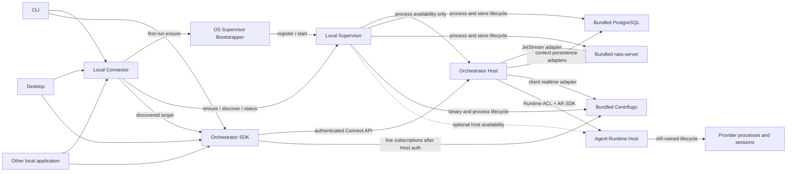

# Local Host Lifecycle

ADR-0115 requires this Fully Local profile in V1 alongside both server profiles.
The profile remains unqualified. ADR-0093 and ADR-0097 keep its package entries
non-materializable until the exact OD-021, OD-035, and OD-040 implementation-start
gates are resolved. ADR-0116 resolves OD-035's engine selection; OD-021 and
OD-040 remain open. Package creation precedes the release evidence it must
produce; it does not itself qualify the profile. Statements below describe the
required local architecture and are not an availability claim.

The [service role map](deployment-profiles.md#service-role-map) owns current
placement and first-role process isolation under ADR-0114. This native V1
profile preserves its selected role processes; it does not silently fold them
into Desktop or one Local Host. A compact native profile requires explicit
approval and its own qualification before replacing any selected isolation.

## Purpose

This boundary makes the durable local orchestrator as easy to use as a normal CLI
while keeping process availability outside orchestration business behavior.

`Local Supervisor` and `Orchestrator Host` are platform and application roles,
not bounded contexts. Full tactical DDD belongs inside business bounded contexts;
inventing aggregates for process discovery or binary activation is prohibited.

ADR-0060 is the current process-lifecycle authority: one shared per-user Local
Supervisor is the sole owner of local Host availability. ADR-0064 separately
defines client-bound and durable product Run lifetime. Desktop, CLI, and other
clients may bootstrap and discover the Host, but never supervise it directly.
ADR-0030 remains authoritative for separate local and hosted compositions.

The first substrate-neutral implementation slice is indexed by the
[local Host control package](../../packages/platform/local-host-control/README.md).
It validates discovery observations only; it does not resolve the open transport
or lifecycle decisions below.

## Process topology



The Supervisor is not on the normal SDK request path. After discovery and
handshake, clients connect directly to the Host public control API.

The diagram shows the public control path and managed dependencies, not a single
process containing every selected service role. Separate role Hosts follow the
service role map; they retain their own composition, admission, and drain.

The SDK obtains an opaque realtime subscription descriptor and short-lived token
from the Host through Connect. Token refresh and feed authorization also return
to the Host. The Local Connector and Supervisor never issue subscription tokens,
select channels, or proxy live publications.

## Responsibility matrix

| Responsibility | Owner |
|---|---|
| Domain policy, commands, queries, runs, and process managers | Owning bounded context in Orchestrator Host |
| UoW, inbox, outbox, projections, and reconciliation | Orchestrator Host and owning feature |
| Public control behavior and SDK capability negotiation | Orchestrator Host |
| Local component discovery and process availability | Local Supervisor |
| Native role Host and paired Dapr sidecar availability and process custody | Local Supervisor |
| Version staging, activation lock, health, and bounded restart | Local Supervisor |
| Local PostgreSQL binary, process, protected data root, endpoint, and custody | Local Supervisor |
| PostgreSQL connections, context migrations, transaction semantics, and recovery validation | Host persistence adapters and owning context |
| Local NATS process, binary, store path, lifetime lock, and resource lifecycle | Local Supervisor |
| Native Temporal service availability, binary activation, protected endpoints, and resource custody | Local Supervisor through the Temporal component adapter |
| Temporal schema migrations and service configuration | Temporal adapter with separate migration authority |
| Workflow scheduling contracts, command receipts, cancellation cutoffs, and business reconciliation | Owning feature; Temporal adapters provide execution mechanics |
| JetStream topology, publish, consume, ACK, and transport mapping | JetStream adapters |
| Event ordering, delivery, privacy, retention, and replay requirements | Owning feature contract |
| Local Centrifugo binary, endpoint, process health, staged activation, and cleanup | Local Supervisor |
| Realtime channel mapping, token encoding, publication projection, and recovery signaling | Centrifugo adapter |
| Durable client feed, cursor, snapshot, feed-scope validation, and classification | Owning feature |
| Product grant, delegation, revocation, and authorization decision | Configured product authority provider; feature-owned ports consume decisions |
| AR host availability when locally managed | Local Supervisor |
| Runtime sessions, AR execution identity and custody, provider processes, sandbox, and permission enforcement | Agent Runtime |
| User defaults for target and scope | Client Profile |
| Team project directory or execution workspace identity | Workspace Registry |

Sharing a low-level process or connection does not transfer semantic ownership.

[ADR-0116](../decisions/0116-native-temporal-for-fully-local-durable-workflows.md)
selects the full native Temporal Service with PostgreSQL for local durable
execution. Its binary and schema transitions must be qualified under this
lifecycle, including sequential supported server upgrades when Desktop versions
are skipped. The Supervisor does not acquire workflow or business-state
authority, and the selected engine does not imply a second generic recovery
scheduler. Production Worker placement remains within the accepted service-role
map and OD-005's concrete workflow boundary.

## Native role processes and Dapr

`daprd` is the Dapr runtime executable, deployed as a sidecar beside an
application role instance. It is not an agent process, a bounded context, or a
second Supervisor. Each native Host instance participating as a caller or
callee in the selected private RPC profile has one paired `daprd` process.
Ordinary local feature calls do not create sidecars. Durable-only JetStream
workers have none unless an actual declared RPC dependency requires one.
PostgreSQL, NATS, Centrifugo, Desktop, and AR do not acquire sidecars merely by
being present in the composition.

The Supervisor owns the availability, generation-bound pairing, protected
endpoints, bounded restart, and custody of each selected Host and sidecar.
Dapr supplies the qualified private standard-gRPC invocation mechanisms; each
Host still constructs its own capabilities once and owns application admission,
authorization, resource limits, and durable recovery. Starting or stopping
`daprd` cannot confer runtime execution custody or authorize stopping provider
processes. Development CLI launch behavior must not introduce a second process
owner beside the Supervisor.

The native profile selects and qualifies its actual resolver, peer identity,
trust roots, credential delivery and rotation, service access policy, and
application/sidecar endpoint protection before activation. Loopback, a Dapr
application ID, discovery success, or a responsive port is not authority.
OD-012 and OD-021 retain their applicable authority and lifecycle gates; local
control endpoint selection remains under OD-001. The RPC selection does not
adopt Dapr state, pub/sub, actors, placement, workflow, Jobs, or Redis.

Readiness separates process liveness, sidecar initialization, application
protocol and identity, compatible schema and durable topology, and current
admission authority. Dapr's sidecar health probe alone cannot establish Host
mutation readiness. If the profile enables Dapr application health checks,
qualify the actual callback: its gRPC channel uses
`dapr.proto.runtime.v1.AppCallbackHealthCheck/HealthCheck`, not the generic gRPC
health service. Keep that callback in an infrastructure adapter and avoid a
circular dependency between Host readiness and sidecar readiness. See the
[official application health profile](https://docs.dapr.io/operations/resiliency/health-checks/app-health/).

## Two control paths

### Bootstrap control

If the Supervisor is absent, an idempotent OS-specific bootstrapper in the local
application composition registers or starts it. This bootstrapper is not part of
the ordinary SDK. Concurrent first-run clients converge through a protected
interprocess lifecycle lock and cannot install or start competing Supervisors.

After Supervisor readiness, the Local Connector uses a narrow protocol for:

- `ensure` the default or explicitly selected local target;
- `discover` the active Host endpoint and instance metadata;
- `status`, `doctor`, `drain`, and explicit administrative update operations.

This protocol exposes no team, task, run, message, or approval operation. Ordinary
SDK packages do not install, start, stop, or update components. A product CLI may
compose the SDK with a separate local-host administration client.

The first implementation milestone is deliberately limited to idempotent
bootstrap, `ensure`, `discover`, readiness/health, and typed diagnostics. Automatic
updates, staged activation, rollback, drain, garbage collection, and full
service-manager recovery remain target capabilities governed by OD-021; they are
not prerequisites for the first local vertical slice.

The default Desktop package includes pinned platform builds of managed local
components, including PostgreSQL. It does not download managed engines on first
launch. The release pipeline verifies provenance and checksum, applies nested
platform signing and notarization, and stages the binaries beside the Host.
The same offline, executable-verification, signing, and supported OS/architecture
requirements apply to each selected native role Host and bundled `daprd`.
Each released native tuple proves installed-package startup, pairing,
authenticated readiness, bounded drain, custody after parent death, and restart;
Linux or container evidence does not qualify Windows or macOS. Native packaging
does not initialize development-only Dapr components as incidental dependencies.
For Centrifugo, the Supervisor starts the memory-engine profile on a protected
rotating endpoint. Users install, configure, or start nothing manually.

Bootstrap, discovery, and administration remain narrow capability surfaces even
if they share one low-level protected connection. Exact public TypeScript names
are deferred, but one broad process-control interface is prohibited.

### Public control

After discovery, the SDK performs an authenticated handshake with the Host and
uses the same versioned Connect control API as other supported clients. Local
transport may remove network exposure, but it cannot bypass authorization,
validation, idempotency, scoping, capability negotiation, or error mapping.

Selection is deterministic. A failed remote target never silently falls back to a
local target, and an unavailable local target never silently selects another
profile.

## Identity and discovery

Keep these identities distinct:

```text
TargetId
SupervisorInstanceId
HostInstanceId
HostBootGeneration
ComponentVersion
```

The stable locator names a trusted local deployment scope. It does not identify
one Host process. A successful discovery result is bound to the active Supervisor
instance, Host instance, boot generation, endpoint, protocol range, capabilities,
and expiry or liveness evidence.

The stable locator contains no Host bearer credential. A per-boot Host credential
is delivered only through the protected Supervisor discovery channel and rotates
with Host identity and endpoint. It never enters argv, inherited environment,
project configuration, or renderer-visible state.

PID, port, socket pathname, and executable pathname are diagnostics, not
authority. A stale locator or endpoint is removed only after ownership and
liveness checks. A foreign live process is never killed or adopted.

Locator replacement uses a temporary owner-only file, file `fsync`, atomic
rename, and parent-directory `fsync`. Truncated, malformed, schema-invalid, stale,
and foreign-identity locators produce distinct typed outcomes. A responsive
foreign endpoint is never unlinked, killed, or adopted.

Durable state and endpoint roots are app owned and private. The implementation
rejects symlink substitution, unexpected file types, and group/world-writable
state before use. Unix-domain socket paths use a short private runtime root rather
than inheriting the potentially long durable data path.

The exact cardinality of Supervisors and local targets, locator representation,
bootstrap credential exchange, and OS-specific endpoint substrate remain in
OD-001 and OD-021.

## Target, profile, and workspace

`Target`, `Client Profile`, and `Workspace` are independent:

```text
Client Profile
  -> selects Target
  -> supplies optional default tenant/project scope

Target
  -> identifies deployment endpoint and trust configuration

Workspace
  -> domain resource inside a project
  -> never controls deployment endpoint or credentials
```

A local Host identity is scoped by installation and data ownership, not by the
current directory, project, workspace, terminal, or client process. Multiple
profiles may reference the same target.

Project-controlled files cannot replace target endpoints, lower trust, select
credentials, or trigger installation. This prevents opening an untrusted
repository from redirecting the CLI to another control plane.

## CLI behavior

For a normal local command, the CLI:

1. resolves one explicit or default Client Profile and Target;
2. bootstraps the Supervisor only when the selected local target requires it;
3. asks the Supervisor to ensure and discover a compatible Host;
4. validates instance identity, protocol range, capabilities, and trust;
5. invokes the Host through the ordinary SDK;
6. for an attached Run, renews its sponsorship until completion or `Ctrl+C`;
7. on `Ctrl+C`, requests bounded Run cancellation and reports incomplete cleanup
   without killing shared infrastructure;
8. for `--detach`, creates durable work and exits with recovery references.

Remote targets skip local bootstrap entirely. Failure never silently changes the
selected target.

A compatible active Host is reused even when a newer component is available. An
ordinary command does not kill or replace it. An incompatible client receives a
typed outcome with actionable version information. Only explicit privileged
administration may initiate drain and activation.

Operational commands such as `host status`, `host version --json`, `host doctor`,
`host drain`, and `host update` are served by the narrow local-host administration
client. Exact command names remain product-level design, but machine-readable
status, bounded waits, and typed degraded states are required.

## Managed PostgreSQL lifecycle

ADR-0114 selects native PostgreSQL for the local profile without choosing
the Desktop shell or a new implementation language. The existing Supervisor is
its process-lifecycle owner. The Host uses asynchronous SQL through its context
adapters; Desktop and the SDK receive neither SQL credentials nor direct SQL
access. A remote Target skips this local component entirely.

One local Target data root contains its durable PostgreSQL cluster independently
of the selected Host binary. Updates preserve that root. Concurrent clients
converge through the existing lifecycle authority; a project, workspace, or
agent never creates another authoritative cluster. OD-021 still determines
supported installation-channel and target cardinality.

Bootstrap and custody enforce these rules:

- initialize only a newly reserved empty data root owned by the application;
  an existing corrupt, foreign, or incompatible root enters typed recovery and
  is never deleted or initialized as an availability fallback;
- pin and verify the actual engine archive, platform payload, helper binaries,
  and release signature; normal startup requires no download or manual database
  installation and creates no OS database account;
- use an authenticated protected endpoint, explicit loopback binding when TCP is
  selected, and generated SQL credentials separate from Host control credentials;
  TCP uses SCRAM with explicit `pg_hba.conf` rules and no `trust` authentication;
  runtime roles are not superusers, migration and maintenance credentials are
  separate, and bootstrap secret files are created with owner-only access;
  a port, PID, pathname, or readiness log line is not cluster identity;
- verify SQL cluster identity, expected data ownership, version, configuration,
  and migration compatibility before exposing Host mutation readiness;
- handle port collisions with bounded retry or a typed unavailable outcome;
  never kill or adopt a foreign process merely to acquire its endpoint;
- preserve custody across Supervisor death while PostgreSQL remains alive;
  reacquiring a parent lock alone does not prove that the child stopped;
- perform bounded graceful PostgreSQL shutdown after Host drain; classify forced
  termination as unclean shutdown requiring crash recovery, and reconcile a
  timeout before starting another process.

[ADR-0114](../decisions/0114-canonical-backend-stack-and-distributed-role-adoption.md) selects
`embedded-postgres` behind the Supervisor's PostgreSQL component adapter. The
Supervisor consumes narrow lifecycle capabilities and typed outcomes; wrapper
classes, process handles, and defaults do not escape that adapter. Exact
production wrapper and engine artifacts remain subject to OD-003 and OD-021.
Product custody cannot depend on the Desktop lifetime or unqualified wrapper
defaults. Qualification must close the reproduced stop-after-exit failure,
including the package's global exit hook, not only the guarded common test path.

The [deeper launcher evidence](../open-decisions/OD-003-persistence-composition.md#deeper-launcher-and-helper-evidence-2026-10-17)
also identifies natural-exit status replacement, an incomplete maintenance-tool
payload, and missing process custody after abrupt launcher death. A dedicated
launcher child is a candidate for containing wrapper-global hooks and temporary
environment changes; it is not a second Supervisor or an OS custody mechanism.
The selected platform adapter must prove the actual survival, termination, or
adoption policy. Do not remove arbitrary process listeners to conceal the hook.

Control authority binds the Target, cluster identity, current Supervisor
generation, launch attempt, and live process identity or custody handle. A
reusable data-root nonce and numeric PID do not grant a failed contender the
right to stop the winning instance. Under the lifecycle authority, revalidate
before control and reconcile its outcome; a timeout does not prove that startup
or shutdown stopped progressing. Losing-attempt cleanup controls only the
processes that attempt owns. Recovery adoption is a separate transition.

Host activation, context schema migration, and PostgreSQL engine upgrade are
separate transitions. Candidate health checks cannot migrate a shared live
cluster before the previous Host is quiesced. Every old writer and dispatcher,
including checked-out database clients, must be fenced before new mutation
authority is granted. Returning the old locator alone does not revoke those
clients.

A PostgreSQL major upgrade or incompatible schema change uses exclusive
maintenance, verified backup, a separately staged compatible cluster or migration
plan, and an explicit activation record. An old binary can resume only against
data it still supports. New accepted writes cannot be silently removed by an
automatic snapshot rollback. A major-version upgrade path must declare its
point of no return; hard-linked old and new data files are not independent
rollback copies. Supported patch and major upgrade paths are qualified before
shipping the corresponding update, not inferred from a wrapper's version string.

The [persistence boundary](persistence-boundary.md#backup-and-restore) owns backup
manifests, context validation, and reconciliation before restored dispatch.
Neither the Supervisor nor a wrapper repairs business tables or substitutes a
second authoritative database when PostgreSQL is unavailable.

### Packaged PostgreSQL qualification

Release evidence binds the exact application, Host, launcher, actual engine,
helper binaries, configuration, OS version, and architecture. Every advertised
platform tuple must pass the applicable rows below. Windows and macOS require
their own installed-package evidence; Linux launcher experiments and unrelated
Local Host Control CI do not qualify PostgreSQL on those platforms.

| Released capability | Required evidence | Qualification owner |
|---|---|---|
| Installation and offline use | Actual installable package, enforced executable/helper/native-library digests, relocatable layout, safe extraction, signing and macOS notarization, and typed rejection when OS quarantine or security software blocks launch. First start and persistent reopen require no engine download; recording hashes alone is not verification | OD-021 |
| Bootstrap and authenticated readiness | New private root only; credential-file permissions and Windows ACLs, removal after success/failure/crash, protected endpoint, collision and foreign-cluster rejection, authenticated SQL identity, actual version, and effective durability settings before Host readiness | OD-021 and OD-003 |
| Lifecycle and process custody | Concurrent ensure, losing-contender cleanup, stale control generations, spawn failure, startup hang, already-exited children, wrapper/global exit hooks and truthful exit outcomes, bounded graceful shutdown on each platform, classified unclean termination, and Supervisor death with a surviving database process without a second owner | OD-021 |
| Application/Host and schema updates | Separate transition records, declared compatibility, no live-schema migration during candidate health checks, drain and fencing of old clients/dispatchers, interruption at each supported stage, and rollback only against compatible current data without losing later accepted writes | OD-021 and OD-003 |
| Engine minor and major upgrades | Exact source/target payload and extension/collation/configuration compatibility; engine changes separate from app or wrapper version changes; recovery after interrupted supported transitions; verified backup and explicit irreversible boundary for incompatible changes; rejection of unsupported paths | OD-021 and OD-003 |
| Backup and restore | Create the selected backup artifact and restore it into a clean isolated root. Validate manifests, integrity, required context schemas and migration checksums, receipts/outbox, blobs, and key access. Reject corrupt, incomplete, or incompatible sets; validate before activation and fence dispatch until fresh authority and reconciliation | OD-003 and owning persistence/context adapters |
| Failure and controlled recovery | Interrupted initialization, update, and restore; disk exhaustion, damaged or unavailable files, and actionable degraded outcomes without deleting or reinitializing existing data. Test the supported recovery procedure; process-kill evidence does not replace power-loss or filesystem durability evidence | OD-021 and OD-003 |

These are release requirements for the corresponding platform and capability,
not completed qualification or a newly implemented CI checker. OD-039 and the
existing deployment attestation process govern the actual evidence binding.
An initial implementation may omit automatic updates; every shipped update or
upgrade path passes its own rows before release. This does not require all
future update features before an initial implementation or disposable experiment.
OD-040 remains the separate materialization decision.

## Lifecycle invariants

- Concurrent `ensure` calls converge on one compatible active Host per local
  target.
- The Supervisor serializes start, drain, activate, stop, and recovery transitions.
- Bootstrap election, Supervisor lifetime ownership, and managed-store lifetime
  ownership are separate locks with separate failure and stale-recovery rules.
- The Supervisor holds the external exclusive lock for every managed NATS store
  for the complete broker-process lifetime.
- PostgreSQL custody identifies the one owned cluster and process across
  Supervisor restart; stale ownership files never authorize a second writer.
- Readiness requires authenticated protocol and capability negotiation, not only a
  listening port.
- Each selected role remains independently restartable; a sidecar or role crash
  cannot transfer another role's admission or process custody.
- Restart is bounded and classified; crash loops become a typed degraded state.
- Client connection counts never determine Host lifetime.
- generic SDK cleanup and observer exit detach only local I/O;
- attached CLI Run lifetime uses explicit sponsorship and cancellation;
- detached durable work survives every client exit;
- Explicit foreground or ephemeral mode never adopts or mutates the durable
  target's store accidentally.
- The Supervisor does not inspect or repair bounded-context tables.
- The Host does not replace its own executable or become its own availability
  supervisor.

## Drain and activation

Storage migration rollback, compatibility windows, mixed-version behavior,
activation failure, and service-manager fallback require the detailed state
machine in OD-021. Implementations must not invent these policies independently.

Each selected role closes application admission and stops new JetStream pulling
before bounded drain. Accepted Units of Work persist their outcomes and required
intents; unfinished work retains its original recovery identity. Required
outbound adapters and sidecars remain available through that drain, then stop
under Supervisor custody. A sidecar shutdown timer or an aborted request signal
does not establish the application admission barrier. Role replacement does not
terminate AR-owned provider execution.

A staged Host activation follows this visibility protocol:

1. acquire the short bootstrap/update election;
2. stage and verify the immutable candidate release;
3. durably record pending activation;
4. start the candidate on a unique boot-scoped endpoint without mutation
   authority or permission to migrate the shared database;
5. require identity, protocol, capability, and preflight attestation without
   migration; this does not attest normal mutation readiness;
6. quiesce the previous Host: reject new mutations, complete bounded in-flight
   Units of Work, and commit command, inbox, and outbox state;
7. complete any required qualified migration, using the exclusive maintenance
   path for incompatible changes, and verify schema compatibility while writes
   remain fenced;
8. atomically replace the stable locator with the selected Host generation, then
   allow only that generation to accept new mutations;
9. keep the previous Host alive but mutation-fenced for a bounded
   stabilization/rollback window;
10. drain remaining transport work and stop the previous Host only after the
   selected candidate remains healthy;
11. commit activation state, remove pending state durably, and reconcile with AR
    and JetStream before full readiness.

The locator swap is the client-visibility pivot, not a substitute for Host
mutation fencing. Existing clients may still hold the previous endpoint, so that
Host must already be quiesced before the selected candidate accepts mutations.
Normal mutation readiness follows migration and compatibility validation.
Before the pivot, recovery retains the previous Host only if the current data
remains compatible; otherwise it stays in maintenance recovery. After the pivot,
recovery either proves the selected generation healthy, fences it and atomically
restores a compatible previous Host, or reports that rollback is unavailable.
Restoring a locator never rolls back accepted writes or establishes data
compatibility. At no point may both generations accept mutations.

## Local and hosted parity

Local and hosted compositions share domain, application, public control, runtime
ACL, and JetStream adapter semantics. They differ only at deployment adapters:

```text
Local:
  Local Supervisor + selected native role Hosts and paired RPC sidecars
  + managed native PostgreSQL + managed NATS + managed Centrifugo memory profile

Hosted:
  deployment platform + selected server role Hosts and paired RPC sidecars
  + PostgreSQL + external NATS + managed Centrifugo clustered profile
```

The hosted platform supervisor does not become a business service, just as the
Local Supervisor is not a bounded context.
Compose and Kubernetes are separate server deployment forms with separate
qualification. Neither substitutes for native package evidence or authorizes
automatic cloud/local mixing; the service role map owns their placement.

Hosted composition may run multiple Centrifugo nodes with a Redis-compatible
engine for connection fanout and short recovery history. Local composition uses
one memory-engine process. Both profiles use the same realtime adapter contract,
while SQL feeds and Connect reconciliation remain authoritative.

## Security boundaries

- Local bootstrap and Host endpoints are never wildcard-bound.
- Local trusted roots, locator files, locks, credentials, and socket paths are
  owner-only and reject symlink or unsafe-permission substitution.
- Secrets are not passed through argv, project configuration, renderer IPC, or a
  shared plaintext locator.
- Desktop renderer uses a narrow validated bridge and receives no lifecycle
  authority.
- Host and Supervisor authenticate instance and protocol generation before trust.
- Administrative lifecycle capability is separate from normal SDK credentials.
- Private RPC and sidecar APIs remain protected from public clients; peer trust
  and sidecar access policy do not replace feature-owned product authorization.
- Logs and diagnostics expose safe identifiers, never bootstrap capabilities.

OD-001 selects the exact Unix socket, Windows named-pipe, or protected loopback
combination.

## Prohibited coupling

Do not:

- import business contexts into the Supervisor;
- put process installation or update logic in the SDK;
- route normal commands through the Supervisor;
- let JetStream subjects or NATS lifecycle enter domain/application code;
- let Centrifugo channels, positions, tokens, or errors enter
  domain/application or public SDK models;
- let Centrifugo or the Supervisor own feed, authorization, publication, or
  recovery semantics;
- let the Supervisor or Host control provider processes outside AR;
- use workspace configuration as deployment or trust configuration;
- branch domain behavior on local, desktop, hosted, or foreground mode.
