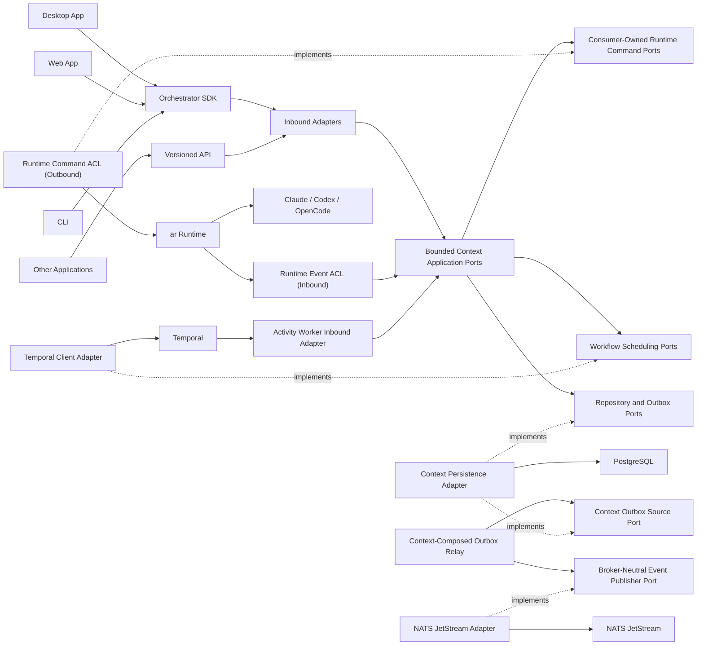

# Architecture Overview

## Branch integration status

The 2026-10-28 reconciliation preserves the canonical ADR-0113 module baseline,
ADR-0114 distributed backend and Dapr/Protobuf roles, and ADR-0115 Fully Local V1
scope. [ADR-0117](../decisions/0117-reconcile-mandatory-module-composition.md)
supersedes the parallel ADR-0110 composition pin while carrying its mandatory
scope and bounded foundation requirements into the canonical baseline. No
accepted decision body is rewritten, and no package or runtime qualification
follows from this integration.

[ADR-0111](../decisions/0111-human-collaboration-and-execution-directory-terminology.md)
records the confirmed collaboration and terminology policy. The dated research
retains its original baselines; earlier branch-status notes there are historical,
not current instructions to restore a monolith, SQLite, or post-V1 local scope.

## Purpose

Agent Teams Orchestrator is a headless control plane for coordinating people and
AI agents through Teams and Tasks. It owns product-level coordination and
delegates AI execution to a provider-neutral runtime. Human manual work does not
require a runtime session or agent activation. Mixed participation is confirmed
product direction; [OD-048](../open-decisions/OD-048-mixed-human-and-ai-team-participation.md)
owns its remaining contracts and implementation admission.

Standalone Self-Hosted and managed delivery share the orchestration core. The
standalone product must support multiple organizations and independent human
memberships without commercial Platform dependencies. The
[deployment profiles](deployment-profiles.md) own qualification; the
[companion Platform proposal in PR #55](https://github.com/agent-teams-ai/agent-teams-platform/blob/a4d47e1c27c3c1efc0e94f770fc9064b0bc17bfc/docs/architecture/platform-orchestrator-boundary.md)
records the hosted relationship at its reviewed, unmerged revision. Platform
does not implement another Task engine. The
[coverage review](../research/collaboration-hierarchy-and-workspace-review-2026-10-22.md)
links each confirmed requirement and unresolved choice to its owner.

The architecture must support:

- desktop, web, CLI, automation, and third-party clients;
- local and hosted deployment;
- Claude, Codex, OpenCode, and future providers through `ar`;
- durable commands, retries, recovery, and integration events with
  contract-declared retention and replay semantics;
- future Temporal workflows without coupling the domain to Temporal;
- coarse service roles from their first delivered workloads, with contracts
  portable across implementation languages;
- one team through thousands of simultaneously running agents as the server
  architecture target, with explicit capacity qualification;
- Docker Compose and Kubernetes server deployment forms.

## Architectural style

The [shared backend reference adoption](../decisions/0114-canonical-backend-stack-and-distributed-role-adoption.md#shared-reference-and-local-adoption)
pins the organization technology catalog and defines its local scope. Exact
contracts, process placement, dependency versions and qualification remain owned
here. The [public HTTP Host](sdk-and-transports.md#public-http-host) uses Fastify
and Connect in one server; private RPC retains the gRPC/Dapr boundary.
Frontend and desktop-shell choices remain outside this backend reference.

The system is a headless event-driven modular control plane deployed through
coarse application and worker roles. It is built with:

- Clean Architecture dependency direction;
- Hexagonal Architecture ports and adapters;
- domain-capability feature slices inside focused bounded contexts;
- strategic and tactical Full Domain-Driven Design;
- selective CQRS read models;
- transactional outbox and idempotent inbox processing;
- strict versioned contracts;
- Get Modular 0.5.0 static capability composition under a selected Host profile.

ADR-0114 replaces the universal monolith-first placement with the
[service role map](deployment-profiles.md#service-role-map). Selected roles are
separate processes from their first owning feature; ordinary internal modules
remain typed local capabilities. Each bounded context keeps its own transaction
boundary even when roles share one physical PostgreSQL cluster. More agents
require capacity and role replicas, not a service or sidecar per agent.

The diagram below shows logical application dependencies, not a single-process
deployment. The deployment profile owns the mapping of capabilities to roles.

## Control plane versus runtime

The orchestrator decides:

- what team should exist;
- what work should be performed;
- who owns a task;
- which dependencies block progress;
- when to send, queue, retry, escalate, or complete work;
- what desired runtime state should be requested.

Workspace Registry owns Execution Directory registration, allocation,
materialization, and cleanup through replaceable adapters for shared directories,
worktrees, clones, snapshots, or remote filesystem views. [ADR-0111](../decisions/0111-human-collaboration-and-execution-directory-terminology.md)
selects this technical term while preserving ADR-0062's model identities and
separate runtime-isolation boundary.

The runtime decides and enforces:

- how a provider session is created and resumed;
- how agent processes are supervised;
- how cancellation and recovery are performed;
- how credentials, leases, fencing, sandboxing, mounts, process isolation, and
  network restrictions work;
- how provider events become normalized runtime events.

The boundary is detailed in [Runtime boundary](runtime-boundary.md).

## Deployment model

The same core supports multiple compositions:

- **Local Supervisor**: the V1 per-user technical deployment-control process. It
  ensures, discovers, monitors, drains, and activates versioned local components.
  It owns no orchestration behavior and is not on the normal SDK request path.
- **Orchestrator Local**: the V1 local Host composition with protected local
  control, bundled native PostgreSQL, local runtime integration, and the JetStream adapter. CLI,
  Desktop, and other local applications share it through the SDK.
- **Orchestrator Server**: the V1 server artifact family with network control,
  PostgreSQL, authority-provider, and JetStream adapters. Managed SaaS and
  Standalone Self-Hosted compositions use the same logical core.
- **Embedded testing composition**: tests use in-memory adapters and a fake
  runtime without launching real agents.

Local and server artifact families contain the selected thin role composition
roots; they are not separate product implementations. A family is not one
mandatory process. Deployment mode must not change domain behavior.

When the Fully Local profile is implemented, the shared per-user Local Supervisor
is the only local process-lifecycle owner.
Desktop, CLI, and other applications bootstrap or discover it and then connect to
the Host; they do not supervise their own Host sidecars. ADR-0060 removes the
remaining historical ambiguity in ADR-0030.

One bounded context has one authoritative persistence profile in a running
deployment. A Desktop using Orchestrator Server does not keep a second local
business write model; any local cache is disposable. Moving context state between
profiles is a versioned logical transfer, never generic local/hosted table
synchronization.

The required normal local experience is zero-touch. The distribution includes the native
PostgreSQL and `nats-server` payloads. The Local Supervisor owns those processes
and physical data-root custody; the Host's PostgreSQL and JetStream adapters own
their connections and protocol behavior. A Desktop using a server Target does
not start unused local infrastructure. The Supervisor may manage AR host
availability, but AR remains the
only owner of provider sessions and processes. See
[Local Host Lifecycle](local-host-lifecycle.md).

ADR-0115 requires Fully Local, Managed SaaS, and Standalone Self-Hosted in V1.
They reuse owned domain/application code, contracts, and PostgreSQL migrations;
composition and operational adapters own deployment differences. This is a
release target, not a statement that the local artifacts exist or are qualified.
The still-blocking implementation and qualification gates and independent client
and execution axes are defined in [Deployment Profiles](deployment-profiles.md).

Client configuration distinguishes:

- a `Target`, which identifies one concrete deployment and trust boundary;
- a `Client Profile`, which selects a target and optional default scope;
- an Execution Directory, which is a project-scoped technical filesystem resource;
- a frontend Workspace, which presents navigation or a saved view over the
  selected Target and authorized Tenant/Project.

Project, Workspace, or Execution Directory configuration cannot redirect a
client, choose credentials, or lower target trust. Workspace adds no permission
owner or Project identity boundary. Exact public resource spelling and any
migration remain open under OD-019. Durable work always survives client exit.
Attached CLI work uses an explicit client-bound Run sponsorship whose clean exit
or fenced expiry requests business cancellation without stopping shared
infrastructure.

## Persistence model

Aggregate repositories hold authoritative business state. Commands update state
and append required integration-event outbox and durable command-dispatch records
in one transaction. Relays deliver those records after commit through their
respective contracts.

The initial design is not event sourced. Event journals support audit, diagnostics,
and simulation. Projection replay is supported only for contracts whose
completeness, retention, upcasting, privacy, and replay authorization make that
guarantee explicit. Making events the authoritative source of aggregate state
requires a separate ADR.

Persistence is context-owned. Platform persistence packages may provide drivers,
transaction primitives, migration tooling, and test harnesses, but they do not own
context repositories, tables, migrations, inboxes, outboxes, or projections.

A transaction changes authoritative state in one bounded context only. Cross-context
effects use integration events and process managers even when all contexts use the
same application process or PostgreSQL cluster.

ADR-0114 selects native PostgreSQL for both local and server authority. The
profiles share owned SQL schemas, migrations, mappings, and semantic conformance;
distribution, connection budgets, backup, version compatibility, and component
lifecycle remain explicit deployment concerns. This selection does not qualify
a bundled launcher or remove Fully Local implementation gates.

## Scope and access

Every team, task, orchestration run, message, and runtime binding belongs to one
project. Execution Directory registrations and allocations belong to Workspace
Registry and use opaque identities rather than arbitrary paths. The existing
`WorkspaceRegistration` and `ExecutionWorkspaceAllocation` model names remain
unchanged by the terminology selection.

Authentication may be delegated to an external identity provider. Inbound adapters
authenticate and establish a principal. The configured product authority provider
supplies membership and grant facts through ACLs implementing feature-owned
authorization ports. Every application use case authorizes its business operation
before mutating or disclosing state; domain behavior enforces identity-dependent
invariants from explicit facts. Exact managed and standalone provider topology
remains open under OD-012.

The public control plane uses feature-owned Protobuf through Connect and compatible
gRPC adapters. Integration events use separate feature-owned JSON Schemas. The
handwritten SDK maps local-Host and hosted Connect targets to one behavioral
surface without exposing generated wire messages. An in-process backend exists
only in the embedded test composition and is not a production SDK mode.

## Read models

Write-side bounded contexts own their context-local projections. A query-composition
adapter may join published read models for a client view, but it does not become an
owner of business state and cannot write context storage.

## Service boundaries and scaling

A Get Modular entry or nested feature is a composition or semantic boundary,
not automatically a network service. ADR-0113 defines one construction authority
per Host role. ADR-0114 selects Protobuf and standard gRPC through Dapr for real
private RPC. Public Connect and direct durable JetStream delivery keep their
separate responsibilities.

The first stateful private product boundary is Control Host to the implemented
Team Topology S3 group in a separate process. Durable coordination, Observation
intake and queries, derived work, Agent Context compute, workspace mechanics,
and outbound effects acquire their required process boundaries with their
first corresponding feature. The
[role map and first-materialization record](deployment-profiles.md#service-role-map)
make this a delivery obligation instead of an unspecified future extraction.

Roles can share a deployment and physical database without merging semantic
owners. Concurrency protection requires owned constraints, revisions, receipts,
claims, and fences. A single active claim for one run, resource, or partition
can coexist with many concurrent replicas; it is not a global singleton writer.
AR retains execution custody, technical capacity, and its private fences.

Additional separation follows declared differences in trust, affinity,
language, rollout, or resource demand before shipping the affected workload.
It preserves versioned consumer contracts and context-owned persistence. A
language rewrite still requires implementing and qualifying the replacement;
standard protocols do not promise zero migration work.

The server target is thousands of simultaneously running agents with concurrent
users. Stored definitions and idle sessions are not capacity evidence.
Qualification declares actual command/event/output rates, bursts, fanout,
dataset, duration, hardware, role replicas, and aggregate budgets and proves
bounded overload, cancellation, tenant isolation, and recovery. Compose and
Kubernetes require their own execution evidence. The strategic context map and
existing implementation readiness gates retain their unresolved scope.

## Non-goals

The first implementation does not aim to:

- build a general-purpose workflow language;
- replace `ar` provider execution;
- make Temporal or NATS part of the domain model;
- expose internal aggregates directly through an SDK;
- migrate all existing desktop task-board code immediately;
- implement every future provider before one vertical slice is proven.
