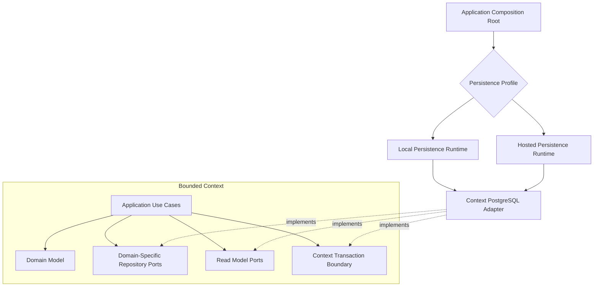

# Persistence Boundary

ADR-0106 selects native PostgreSQL for the server profiles and the future Fully
Local profile. The local deployment bundles and manages an ordinary PostgreSQL
process; it does not use an in-process SQL emulator. ADR-0087 still selects only
Managed SaaS and Standalone Self-Hosted Server for V1. Native local persistence
remains deferred behind the existing implementation and qualification gates;
this engine decision does not authorize placeholder repositories or local
package materialization. Interface-level fixtures and disposable spikes remain
allowed.

## Principle

Persistence is replaceable infrastructure, but data ownership and transaction
semantics are part of each bounded context.

Domain and application code must not depend on SQL dialects, ORM entities, database
clients, table schemas, or storage capability checks.



The application host selects one persistence profile during composition. Use cases
do not branch on a database engine, `desktop`, or `hosted`.

## Port design

Repository ports express aggregate semantics:

```ts
interface TaskRepository {
  get(scope: ProjectScope, id: TaskId): Promise<Task | null>;
  save(task: Task, expectedRevision: Revision): Promise<void>;
}
```

Query ports return purpose-built read models and do not rehydrate aggregates.

Do not introduce:

- `Repository<T>`;
- generic CRUD services;
- a universal aggregate table;
- ORM entities in domain or application;
- a shared SQL abstraction invented by the orchestrator;
- database capability checks inside use cases;
- one transaction interface shared across bounded contexts.

## Capability-scoped Unit of Work

Every mutating domain capability owns the smallest Unit of Work port that can
preserve its invariants. It bundles only the repositories and transactional
capabilities that the use case needs. It does not expose a database transaction,
driver, ORM session, or generic repository registry.

One bounded-context transaction coordinator assembles feature-owned Unit of Work
implementations over the selected persistence profile. This is technical
composition, not ownership of feature repositories or schemas. Nested,
cross-context, and caller-provided transactions are prohibited.

## Context-local transaction

One transaction may atomically change only one bounded context:

```text
aggregate state
+ aggregate revision
+ durable command receipt
+ context-local projections required by the command
+ integration-event outbox records
+ durable command-dispatch records
= one local database transaction
```

An event consumer stores its inbox decision, cursor where applicable, and business
effect in the same context-local transaction.

Cross-context transactions, foreign keys, direct joins, and table writes are
prohibited. Query Composition joins published read models at the edge.

## Physical ownership

Each bounded context owns:

- repository and query adapters;
- tables and indexes;
- one ordered migration manifest assembled from feature-owned contributions;
- outbox and inbox schemas;
- durable command-dispatch schemas;
- projection checkpoints;
- retention and archival rules;
- backup/restore validation for its data.

A platform persistence package may provide connection factories, driver wrappers,
transaction primitives, migration execution, health checks, and test harnesses. It
does not define context tables, repositories, or migrations.

Sharing a physical database server or connection pool does not merge context
ownership.

## Local and hosted profiles

Both profiles initially use one PostgreSQL application database with one schema
per bounded context. The server deployment supplies its database endpoint. The
future Fully Local deployment owns one bundled PostgreSQL cluster and database
per local Target data root, shared by its contexts and clients. Component updates
preserve that data ownership; clients, workspaces, projects, and agents do not
create independent authoritative clusters.

Context-owned PostgreSQL adapters, schema declarations, immutable SQL migrations,
codecs, and applicable conformance suites are shared. Connection configuration,
resource limits, process lifecycle, replication, and recovery policy remain
deployment concerns. A supported version and capability matrix qualifies the
engine, driver, Drizzle, extensions, encoding, and collation assumptions. The same
SQL family does not prove equivalent operating-system or deployment behavior.

Exactly one profile is authoritative for each bounded context in one running
deployment. A Desktop connected to a hosted orchestrator uses hosted authority;
local storage may hold explicitly disposable client cache or client-owned state
but never a fallback aggregate repository. Clients use the Host's public control
and feed contracts, never its SQL endpoint or credentials. Local and hosted
databases are not dual-written or synchronized table by table. Context movement
uses the logical transfer protocol preserved by ADR-0106 from ADR-0048. SQLite
and PGlite are not alternative authoritative profiles or automatic fallbacks.

### Shared PostgreSQL semantics

Both profiles use explicitly qualified context namespaces:

```text
orchestration_scope.*
team_topology.*
work_coordination.*
run_orchestration.*
agent_communication.*
```

Schemas are ownership namespaces, not permission to join contexts. Cross-schema
foreign keys, writes, transactions, and direct query composition remain
prohibited.

SQL uses explicit schema qualification rather than relying on a broad
`search_path`. Each context owns its migration manifest. Runtime and migration
roles receive only the privileges required for their context schemas.

Future tenant routing may move a context or tenant to another database or cluster
without changing domain/application contracts.

The TypeScript Host uses asynchronous `node-postgres` in both profiles. Every
Unit of Work owns one checked-out client from begin through commit or rollback;
repositories never obtain independent pool clients inside that Unit of Work.
No external service, broker, runtime, filesystem, Temporal, or other external effect
occurs inside the transaction. Complete outbox or durable command-dispatch
intent is committed first.

Every mutating capability declares its PostgreSQL concurrency profile before
implementation. It identifies the invariant, conflicting command set, revision
rule, constraints, lock order, isolation level, complete-Unit-of-Work retry
policy, and unknown-commit reconciliation. ADR-0106 applies ADR-0050's conflict
evidence to both local and hosted PostgreSQL. Neither a local process mutex nor
an in-memory fixture proves database concurrency safety. A synchronous SQLite
command lane or per-repository Worker RPC is not the local default.

ADR-0078 makes that obligation executable through a federated build-time evidence
gate. Each discovered write entry point belongs to one mutation, every mutation
owns one consistency contract, every enabled persistence profile resolves a
compatible binding, and every selected strategy requires independent evidence.
Standard PostgreSQL strategy mappings are declared once per context
adapter or profile rather than copied into every mutation. The gate does not
provide locks, transactions, or a production handler registry.

### Native local PostgreSQL

This profile remains deferred from V1. The Local Supervisor owns the PostgreSQL
binary, process, protected data root, endpoint, and lifecycle. Host persistence
adapters own connections, context migrations, SQL behavior, and context recovery
validation. Desktop and the SDK own neither responsibility. The
[Local Host lifecycle](local-host-lifecycle.md#managed-postgresql-lifecycle)
defines bootstrap, authentication, process custody, and activation safeguards.

For a Node lifecycle substrate, `embedded-postgres` is the first qualification
candidate. `postgresql_embedded` is considered only when a Rust lifecycle
substrate is independently selected. Neither choice selects the Desktop shell,
introduces Rust solely for a library score, or replaces the TypeScript Host.
The 2026-10-03 candidate versions recorded by ADR-0106 are evidence pins, not
production-approved dependencies. Only one launcher implementation is maintained
by default.

Persistent data is explicit. Startup verifies the effective `fsync=on`,
`full_page_writes=on`, and `synchronous_commit=on` configuration as well as engine
and schema compatibility. Temporary-data defaults, runtime engine downloads,
and a weaker durability setting cannot silently become normal local operation.
Local crash recovery does not imply hosted high availability or protection from
device loss. OD-003 owns the supported backup and recovery profile.

### Admission and resource budgets

Both profiles bound command admission, pool waits, result sizes, relay batches,
and transaction duration. Fair scheduling preserves cancellation, health, feeds,
inbox, outbox, and recovery under load. Database I/O being asynchronous does not
bound JavaScript result decoding or an admission queue.

Composition sets a total connection budget across context roles, Host replicas,
background workers, and maintenance. Connections and pools are not allocated per
agent; independent context defaults cannot exceed that deployment budget.
Queue depth, pool wait, transaction latency, lock wait, timer lag, rejection,
backlog, and disk headroom are observable. PostgreSQL WAL and temporary files,
NATS, blobs, logs, and backup staging share the local storage budget. Required
receipts and dispatch intent are never discarded as an overload shortcut.

An advertised workload of 100 or more active agents requires representative
command and event rates, bursts, payloads, fanout, data size, duration, and
packaged hardware. A single SQL client or idle connection count is not evidence
for that workload. Numerical limits remain subject to the existing reliability
qualification and approval rules.

### Hosted PostgreSQL operations

Primary-only reads are the default hosted consistency profile. Replica reads are
an explicit query capability with declared eventual-consistency or required-LSN
semantics. A reconnect never silently sends read-after-write traffic to a replica
that has not replayed the required LSN.

Replication durability is a deployment profile, not an adapter guess. An
asynchronous profile may lose acknowledged transactions after primary failure.
A synchronous `remote_apply` profile may provide a stronger tested RPO at the
cost of commit latency and dependency on standby availability. Every deployment
declares its RPO, degraded-write policy, promotion authority, and recovery
procedure.

Promotion publishes a new endpoint and monotonic deployment epoch. Pools and
checked-out clients are recreated, tenant context is rebound per transaction, and
stale expected epochs fail before mutation. The former primary remains fenced and
stopped until `pg_rewind` or reinitialization plus an authority decision makes it
safe to rejoin.

Physical PITR restores one PostgreSQL cluster and therefore all bounded-context
schemas in that cluster to one recovery point. The recovery coordinator validates
the requested target against immutable base-backup and WAL catalog metadata
before starting PostgreSQL. A target older than the base backup is rejected
before process creation because PostgreSQL itself may otherwise recover to the
earliest consistent point and become writable.

Restore readiness requires verified backup integrity, complete and uncorrupted
WAL through the target, promotion of a fresh isolated cluster, context watermark
checks, compatibility validation, and explicit endpoint activation. Missing,
corrupted, or insufficient WAL fails closed. Selective bounded-context restore is
a separate logical export/import and reconciliation operation, never a partial
physical PITR.

### Optional PgBouncer profile

Direct PostgreSQL is the canonical hosted semantic reference. PgBouncer
transaction pooling is a supported optional profile behind the same persistence
adapter contract when its exact PostgreSQL, PgBouncer, and `node-postgres` tuple
passes conformance.

Every Unit of Work retains one checked-out client for:

```text
BEGIN
-> bind verified tenant with transaction-local set_config
-> execute all repository operations
-> persist state, command receipt, and outbox
-> COMMIT or ROLLBACK
```

A repository cannot call the pool independently while a Unit of Work is active.
Every reconnect or whole-UoW retry obtains a client and binds tenant identity
again.

The transaction-pooled runtime profile prohibits session-scoped state, including
plain tenant `SET`, SQL-level `PREPARE`, `LISTEN`, session advisory locks,
preserved temporary tables, holdable cursors, and Unit of Work execution through
statement pooling. Protocol-level named statements require explicit PgBouncer
prepared-statement support and a conformance-tested nonzero cache setting.

Runtime traffic uses the PgBouncer runtime endpoint and constrained database role.
Migration and elevated maintenance use separate direct endpoints, credentials,
and pools. PgBouncer is neither an authorization boundary nor a substitute for
application tenant predicates and forced PostgreSQL RLS.

### Adapter-local Drizzle

Drizzle provides query, schema, and migration tooling inside the context-owned
PostgreSQL persistence adapters. Drizzle types and generated models never enter
domain, application, feature contracts, or public SDK packages.

ADR-0106 preserves ADR-0052's default toolkit and direct-driver contingency while
removing the obligation to maintain SQLite repositories. Versions are pinned
exactly after a dependency-readiness review and verified through import,
migration, and conformance tests. Released migrations remain immutable SQL
artifacts and are not regenerated when tooling changes.

Local and hosted deployments reuse the same feature-owned repository and query
implementation where its capability matrix applies. Operational differences stay
in their owning adapters and composition. Reuse does not require a universal
repository, base repository hierarchy, dialect framework, or a second local
repository tree. A measured correctness difference receives an explicit binding
and conformance evidence rather than a deployment branch in a use case.

### Exact quantities, money, and instants

ADR-0046 governs authoritative counts, quantities, rates, and money.

- Domain and application code use context-owned exact value objects. Decimal,
  Dinero, Drizzle, and driver types remain adapter or implementation details.
- PostgreSQL uses bounded `bigint` and `numeric(precision, scale)`. Node-postgres
  string results remain strings until context mapping.
- PostgreSQL exact values are cast to text before JSON construction. JSON numeric
  parsing is not a lossless codec for `bigint` or arbitrary-precision `numeric`.
- Every database aggregate has an explicit range or overflow strategy; result
  mapping uses checked exact arithmetic rather than JavaScript `number`.
- Persistence records retain scale, unit, basis, currency, rounding policy, and
  algorithm/version references required by their owning context.

The initial exact mapping profile is:

| Semantic value | Local and hosted PostgreSQL |
|---|---|
| Bounded whole count | `BIGINT` read as string |
| Exact quantity | coefficient `NUMERIC(P, 0)` plus `SMALLINT` scale |
| Money | coefficient `NUMERIC(P, 0)`, scale, currency |
| Exact instant | `TIMESTAMPTZ(6)` read and written as text |

`P` comes from an explicit domain bound and overflow policy. PostgreSQL special
numeric values are rejected. A fixed-scale
`NUMERIC(P, S)` requires a later type-specific decision naming its insertion,
rounding, and overflow behavior.

The domain represents exact time as `ExactInstant` backed by epoch microseconds.
Wire form is UTC RFC3339 with fixed microsecond precision. JavaScript `Date` and
Temporal implementation objects do not enter persistence records, application
models, Published Languages, or SDK contracts. Provider timestamps with finer
precision remain raw evidence, while sequence, cursor, revision, or fence defines
business ordering.

Local and hosted profiles round-trip the same canonical values and produce
identical domain outcomes. ADR-0049 retains the historical SQLite mapping; it
does not require a current SQLite implementation.

### High-volume facts and projections

Append-heavy usage observations and rated entries retain two physically distinct
responsibilities:

- a compact source-receipt ledger protects global source identity and
  deduplication across every retention window;
- immutable fact tables retain normalized or rated evidence and may be partitioned
  in hosted PostgreSQL after workload evidence selects the key and interval.

Deleting or detaching a fact partition cannot make an old source identity
acceptable again. Corrections append new facts with stable references to the
superseded evidence. Raw provider payloads may move behind a content-addressed
BlobStore reference without deleting the canonical receipt or normalized fact.

Local retention initially uses bounded batch deletion, archival, and vacuum
policy behind the same context capability. Hosted partitioning is not enabled
locally merely because the engine supports it. The application observes
identical receipt, correction, cursor, and retention semantics rather than
identical physical maintenance.

Rollups are versioned, rebuildable read projections. Each records source cursor,
watermark, projector version, and dimensional scope. Statistics may read them,
but budget admission, quota reservation, accounting close, and correction
authority use their owning aggregate state or authoritative facts. A projection
cannot silently become a write-model invariant because it is faster to query.

Execution Observation uses a stricter three-part boundary. Canonical evidence,
safe activity projection, durable feed changes, payload manifest, and indexing
outbox may share one context database transaction. The encrypted diagnostic blob
is written durably as a staged object before that transaction, and search is
updated with idempotency after commit. Orphan collection, payload-unavailable state,
blue/green index generations, authorization-bound cursors, and deletion epochs
provide recovery. Filesystem, S3, KMS, FTS, and future search-engine primitives
remain private to their outbound adapters; they are not a global `ArtifactStore`
or part of the context Unit of Work. ADR-0085 owns the complete protocol.

Driver errors are translated inside each adapter into stable persistence
outcomes. PostgreSQL SQLSTATE values and ORM exceptions never enter application
contracts.

The transaction coordinator tracks commit progress internally:

```text
before-commit
commit-dispatched
commit-acknowledged
```

A dependency loss before commit is proven `not-committed` and may retry the exact
same command ID. Once commit has been dispatched, a lost response is
`unknown-outcome` regardless of the raw driver error. It is not automatically
retryable and is reconciled through the durable command receipt using the same
command ID. Commit phase never becomes a domain concept or public transport field.

Detected corruption indicates untrusted state and enters controlled recovery
rather than transient availability retry. PostgreSQL adapters install
error listeners on the pool and every checked-out client because a connection
failure may emit independently of the rejected query. Unhandled driver events
cannot escape as process-level crashes.

JSON storage representation is not semantic identity. PostgreSQL `jsonb`,
Protobuf, and JavaScript objects may preserve or reorder fields
differently. Command fingerprints and idempotency comparisons use one versioned
canonical application representation before persistence.

## Conformance requirements

Persistence verification has three owners:

- platform-owned technical harnesses for transactions, crash simulation,
  migrations, and backup/restore;
- context-owned semantic suites for aggregate concurrency, scope, repositories, and
  queries;
- capability suites for event outbox, durable command dispatch, inbox, tenant
  isolation, and projection cursors when a context uses that capability.

Failure suites inject disk full, busy/locked/read-only state, corruption,
pre-commit disconnect, lost commit acknowledgement, timeout, deadlock,
serialization conflict, and dependency restart. They verify both atomic state
and stable safe error mapping.

Hosted replication and PITR suites additionally exercise asynchronous data loss,
synchronous commit, primary death, promotion, endpoint and epoch replacement,
old-primary fencing, replica-lag read rejection, WAL archive, physical base
backup, selected-point restore, and too-early, too-late, missing-WAL, and
corrupted-WAL negative controls.

Native local and hosted PostgreSQL bindings of the same context capability pass
the same applicable semantic and capability suites. Local packaging and lifecycle
qualification remains separate from hosted HA, replication, and PITR evidence.
Tests verify behavior, not identical performance.

Usage-capability persistence additionally verifies exact-value round trips above
`Number.MAX_SAFE_INTEGER`, decimal scale conversion, malformed canonical strings,
currency mismatch, allocation conservation, explicit rounding, aggregate overflow,
PostgreSQL numeric codecs, exact values
inside JSON, microsecond instant preservation, negative epoch conversion, DST
period boundaries, and local/hosted semantic parity.

Every supported PgBouncer profile runs the PostgreSQL semantic suite plus
transaction-pooling hazards, physical-backend switching, tenant-state reset,
prepared-statement behavior, endpoint separation, and whole-UoW retry after
backend loss.

## Migrations

Each feature owns the schema fragment and migration implementations for the tables
inside its outbound persistence adapter. A feature migration contribution declares
its semantic migration ID, PostgreSQL implementation, dependencies, and compatibility
metadata.

The bounded context assembles all feature contributions into one deterministic,
validated migration manifest. This assembly layer owns ordering and exposes one
context migration entry point; it does not absorb feature schemas or SQL.

Migrations are immutable after release and shared by qualified local and hosted
bindings. The context plan classifies each step as transactional or
online-resumable; engine-version requirements belong in compatibility metadata.

Hosted zero-downtime changes use expand, migrate, and contract phases. Destructive
desktop migrations require a verified backup or another explicit forward-recovery
path before mutation.

The application composition root invokes each context migration entry point but
cannot edit, reorder, or merge context schemas. One migration runner and lock exist
per context deployment. Features never run migrations independently or compete for
that lock.

The migration lock covers metadata bootstrap as well as migration execution.
The PostgreSQL adapter acquires its context-scoped advisory lock before creating
or inspecting migration metadata. A direct maintenance connection owns that lock;
transaction pooling cannot supply its session lifetime. Connection timeouts and
`CREATE TABLE IF NOT EXISTS` do not replace the lock. Cluster initialization is a
separate Supervisor lifecycle operation, never a feature migration.

For a transactional step, SQL, immutable checksum history, and the completed
watermark commit atomically. An online-resumable step first records immutable
intent and generation, then executes an idempotent non-transactional operation,
reconciles ambiguous outcome, verifies postconditions, and only then records
completion. A process that loses acknowledgement re-reads state under the same
lock; it does not reapply blindly. Incomplete, failed, or newer-than-supported
steps reject normal application startup unless an explicit compatibility phase
permits coexistence.

Host activation, schema migration, and PostgreSQL engine upgrade are separate
operations. A candidate Host cannot migrate the shared live database during its
pre-activation health check. An incompatible migration or major engine change
requires exclusive maintenance, verified recovery artifacts, staged activation,
and the compatibility procedure in
[Local Host lifecycle](local-host-lifecycle.md#managed-postgresql-lifecycle).
Returning to an older binary never silently restores an older data snapshot or
discards writes accepted after activation.

## Tenant isolation

Tenant and project scope are mandatory inputs to repositories and queries for
tenant-owned state. Database constraints and row-level controls provide
defense in depth; they do not replace application authorization.

Both PostgreSQL profiles apply two independent controls:

1. application commands and repositories derive `TenantId` from verified
   authority context and include `tenant_id` in every tenant-owned read and write
   predicate;
2. the PostgreSQL adapter binds that verified tenant with transaction-local
   `set_config(..., true)`, and tenant tables enable and force row-level
   security.

Session-level `SET` is forbidden for tenant identity because pooled connections
can leak it to later borrowers. A failed transaction is rolled back before client
release. Every retry obtains or reuses a valid connection, opens a new
transaction, and binds tenant context again.

Runtime, migration, and elevated maintenance or cross-tenant dispatcher work use
separate pools and credentials. Runtime roles are non-superuser, have no
`BYPASSRLS`, and cannot assume elevated roles. Table owners and `BYPASSRLS`
identities are never runtime traffic identities. Elevated background work still
carries explicit tenant identity in durable records, outbox envelopes, logs, and
audit.

The hosted persistence adapter may later route tenants between shared schemas,
dedicated databases, or dedicated clusters. That routing remains outside domain
and application code.

## Backup and restore

Backup is not a raw file-copy assumption. Every profile defines:

- consistency point across its context stores;
- mutation pause or online-snapshot protocol;
- encryption and secret handling;
- retention and rotation;
- integrity verification;
- restore rehearsal;
- behavior when one context restore fails.

A product backup combines an engine-supported consistent SQL artifact with a
versioned manifest and the required immutable BlobStore artifacts. Referenced
objects remain protected from collection for the backup's retention period.
One PostgreSQL snapshot does not atomically capture NATS, AR, filesystem objects,
or external effects. The declared recovery protocol coordinates those boundaries
without creating a cross-context transaction.

The local backup coordinator uses narrow context-owned participant capabilities:

```text
ProductBackupCoordinator
  -> request one generation and deadline
  -> each context closes mutation and dispatch admission
  -> each context drains in-flight work and records its watermark
  -> the storage adapter creates one consistent PostgreSQL artifact
  -> coordinator verifies and activates one versioned manifest
  -> every context resumes admission
```

The coordinator owns generation, participant set, deadline, recovery journal,
manifest publication, and all-participant release. It cannot inspect business
tables or bypass context admission. Each context closes every mutation source,
including inbox consumers, timers, and background writers, drains its Unit of
Work, and supplies migration metadata and compatibility validation. The storage
adapter owns the engine backup primitive. A participant timeout aborts the
generation without moving the active backup pointer.

The manifest records Target and backup identity, engine and artifact format,
configuration compatibility, artifact sizes and hashes, protected blob references,
and each context's schema, migration checksums, application compatibility, and
watermark. An engine snapshot or WAL position is technical recovery evidence,
not a global business transaction or ordering guarantee. OD-003 selects the
initial local artifact and retention policy; it does not require maintaining
multiple backup implementations.

Restore acceptance requires more than a database engine integrity check. Before a
restored context becomes active, the adapter verifies:

- physical integrity appropriate to the engine;
- expected schema objects and constraints;
- immutable migration IDs and checksums;
- supported applied-version watermark;
- context and backup-manifest identity;
- capability invariants such as state, command receipt, and outbox consistency.

Physical restore activates an isolated verified PostgreSQL cluster as a unit.
Hosted PITR uses a base backup and continuous WAL to one recovery point. A local
whole-database dump, if selected, is a logical product backup with separately
validated role and configuration recovery, not PITR. A schema-scoped dump is a
logical context export/import artifact and cannot replace unrelated schemas.

Large provider payloads, prompts, logs, attachments, and artifacts do not live in
hot relational tables by default. Their owning feature stores metadata, content
hash, retention policy, and an opaque BlobStore reference. Local composition may
use a content-addressed filesystem adapter and hosted composition an S3-compatible
adapter. Credentials and encryption keys remain behind SecretStore capabilities,
never in context databases.

Local product restore supports two explicit modes:

- `all-or-nothing product set` requires and validates the complete expected
  context set;
- `explicit selective contexts` uses logical import and reconciliation for an
  operator-selected allowlist, never partial physical restore or automatic
  fallback.

Restore runs under exclusive product maintenance with a durable recovery journal,
staging area, and a verified recovery set. Normal access never observes partially
activated SQL, blob, or context state. Restoring old data is distinct from
rolling back a Host binary and cannot silently discard acknowledged later writes.

A restored receipt ledger may predate external actions that already occurred.
Dispatch therefore remains fenced until the owning participants reconcile AR,
broker, and external receipt evidence; a missing restored receipt does not prove
that an effect never happened. Unknown outcomes remain explicit. Current
authorization, retirement, and deletion requirements still govern access.

Restore activation establishes fresh recovery authority and retires stale
connections, grants, and dispatch generations. An epoch restored from the same
snapshot cannot by itself prove that authority never moved backwards. OD-003 and
OD-021 must qualify the recovery-generation or explicit Target-rebinding mechanism
before dispatch resumes. Database recovery never grants permission to replay
external effects blindly.
