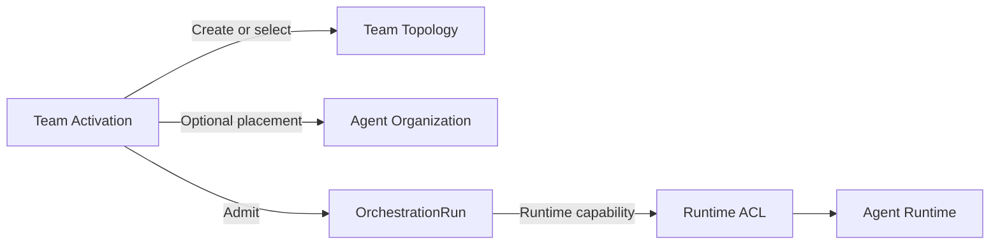

# Run Orchestration

## Accepted implementation scope

ADR-0103 accepts only `src/features/team-activation/` for the server sandbox
runtime migration. This status describes that bounded scope; it does not admit
other capabilities from the broader model below. Existing accepted ADR invariants
remain binding. The owning reserved package and LikeC4 identity do not change.

## Domain vision

Coordinate a durable sandbox Run without acquiring runtime, Work or Conversation authority.

## Scope

Owns: Single-member Run admission, immutable plan/policy references, Agent occupancy, staged activation, cancellation and planned WorkPlacement.

Excluded from this admission: Task lifecycle, actual WorkExecution dispatch, runtime process custody, provider policy and broader resilience/roster changes.

## Ubiquitous Language

Run is product authority; Participant is Run identity; activation is durable process state; planned WorkPlacement links authorized Task evidence without assigning or executing it.

## Invariants and business rules

One unreleased active Agent occupancy; lifetime runtime binding belongs to one Run; unknown stop retains occupancy; cancellation cannot be undone by late output; product Operations never alias RuntimeOperations.

## Aggregates and consistency boundaries

| Root and identity                                                  | Protected invariants | Commands                                                       | Domain events                                      | Transaction                                                          | Concurrency                                                                                                                      | Growth bound                                                                                       | External facts                                                                                                                       | Rejected boundaries                                                     |
| ------------------------------------------------------------------ | -------------------- | -------------------------------------------------------------- | -------------------------------------------------- | -------------------------------------------------------------------- | -------------------------------------------------------------------------------------------------------------------------------- | -------------------------------------------------------------------------------------------------- | ------------------------------------------------------------------------------------------------------------------------------------ | ----------------------------------------------------------------------- |
| OrchestrationRun, immutable RunPlanVersion and occupancy authority | Invariants above     | CreateRun; PlanWork; CancelRun; Run/readiness/Run-task queries | RunAdmitted; WorkPlanned; RunCancellationRequested | One owner-local Unit of Work including receipt, Operation and outbox | Run authority generation and occupancy serialize admission; stale ETags/generations reject; child UUIDs persist before dispatch. | One member/Run in this slice; history and receipts stored separately with finite declared horizons | Exact Team version, Work reference/ETag, immutable context/policy references, current authority and normalized runtime observations. | No provider-state mirror, cross-context aggregate or shared transaction |

Repositories persist only the owning roots/state; read queries use authorized
projections. Transport schemas and persistence records map to separate domain and
application models. IDs and ExactInstant values enter through explicit ports;
no provider/transport/database type enters business policy.

## Commands, processes and errors

Admitted -> activating -> active; authorized cancel -> cancelling -> cancelled only after confirmed containment. Unknown stop -> failed-unknown. Conversation child uncertainty remains partial/pending.

Application processes persist stable child identities, checkpoints and external
intent before dispatch. Domain events above express local facts; integration
publication intent and wire events remain separate mapped surfaces. Typed errors
include forbidden scope, stale authority/ETag, conflicting request and explicit
unknown outcome. A timeout never authorizes an unkeyed effect or legacy replay.

## Concurrency and conflict model

Run authority generation and occupancy serialize admission; stale ETags/generations reject; child UUIDs persist before dispatch.

Persistence owns one context schema, local transaction and forced RLS boundary.
The server borrows its low-level pool; it never borrows another context's Unit
of Work, repository or transaction. Rehydration validates invariants and exact
values rather than trusting a transport DTO.

## Context relationships

Consumer-owned Team, Work, Context, Communication and runtime ports cross owners; adapters never import their aggregates.

## Security and authorization

Trusted scope and subject come from the selected authority adapter. The sandbox
authority is explicitly test-only, current grants apply on replay and reads, and
no prompt/provider payload can select trusted identity. Raw secrets and protected
payload remain in their owning adapters. This admission does not qualify a
deployment, authorize user-project testing or weaken accepted privacy rules.

## Verification scenarios

Cancel absorbs late ready/output; response loss resolves the original child; unknown handoff never replays; planned Task list excludes other Runs; exact Team-version discovery never guesses latest session.

The [accepted sandbox contract](../../../contracts/desktop-runtime-migration-admission-v1.md)
links deterministic fixtures and exact Protobuf sources. Actual domain,
rehydration, concurrent PostgreSQL transaction, response-loss and restart tests
are required with implementation; their names follow the scenarios above.
Synthetic admission models do not assert adapter or provider qualification.

## Implementation links

The package remains reserved until the canonical Plan/Apply scaffolder runs.
The accepted feature's colocated documentation, public entrypoints, source
boundaries and feature allowlist are materialized in the same implementation
change. No other feature is authorized by this dossier status.

## Excluded model and unresolved questions

OD-005, OD-006 and OD-013 retain broader process, aggregate and failure-policy questions.

The following retained material describes broader context discovery and existing
ADR references. Proposed behavior outside the accepted feature remains excluded
and must use its owning decision process before implementation.

Proposed scope: `OrchestrationRun` authority, immutable `RunPlanVersion`
artifacts, `RunPlanTransitionProcess`, resilience-policy snapshots, Run
participants and activation, `ManagedRuntimeBinding`, business checkpoints,
separate `RunRuntimeTarget` inventory, Run authority generation and cutoff
obligations, lifetime runtime-session allocation tombstones, business-effect
references, retry, escalation, completion, compensation, Work placement, and
desired-versus-observed reconciliation. Technical execution remains owned by
`ar`.

### Mixed-team participation boundary

The mixed human and AI Team direction does not change the accepted AI Run roster
implicitly. ADR-0101 still requires the exact source Team version, normalized
Run-only overlay, materialized effective Agent participants, and exact Agent
definition versions. Agent occupancy remains exclusive and durable; it is not
applied to humans as a substitute for Task assignment.

Human manual Tasks need no Run or AR session. Whether a human becomes a product
Run participant, and how that affects waiting, coordination, cancellation, or
completion, remains in
[OD-048](../../../open-decisions/OD-048-mixed-human-and-ai-team-participation.md).
A later mixed roster must define typed selection and snapshot semantics before
adoption; neither silently dropping human members nor creating artificial runtime
bindings is an accepted mapping. ADR-0103's single-Agent admission remains intact.

The `team-activation` feature owns the durable composite process that creates or
selects a Team, optionally requests organizational placement, and admits a Run.
Team persistence remains in Team Topology, placement remains in Agent
Organization, and technical execution remains in AR. The process stores only
opaque references, child command identities, typed step requirements, partial
outcomes, cancellation state, and reconciliation evidence.



Failure after Team creation never causes implicit Team deletion. Successful
activation means durable Run admission, not participant or provider readiness.
ADR-0076 owns the complete boundary.

ADR-0065 fixes the following consistency boundaries:

- `OrchestrationRun` is the small authority aggregate;
- `RunPlanVersion` is an immutable validated artifact;
- `RunPlanTransitionProcess` stages and promotes plan versions;
- `RunParticipant` is stable product identity while `ParticipantActivation`
  tracks one activation lifecycle;
- `WorkPlacement` is feature-owned durable application process state in this
  context;
- `WorkExecution` and all Task or Work lifecycle changes remain in Work
  Coordination;
- `RuntimeOperation` remains in AR.

ADR-0079 further fixes the runtime integration boundaries:

- `ManagedRuntimeBinding` is a bounded participant-to-runtime association and
  never an unbounded operation or receipt collection;
- `RunRuntimeTarget` is separate durable process state for one accepted runtime
  target and its exact authority evidence;
- Run authority admission, suspension high-water marks, and target registration
  serialize through one Run-owned authority gate;
- one RuntimeSession is permanently associated with at most one independent Run
  in v1 and leaves a non-reusable allocation tombstone;
- reauthorization creates a successor RuntimeOperation and never reopens its
  predecessor;
- consumer-owned ports express Run intent, while the Runtime ACL only translates
  representations and owns no binding, cursor, checkpoint, or recovery state.

ADR-0101 adds the participant-admission product rules:

- every immutable `RunPlanVersion` records its exact source Team version, typed
  Run-only roster overlay, and fully materialized effective participants;
- a Team edit and a Run-only exclusion, replacement, or coordinator change are
  different commands with different owners;
- the effective coordinator is one ordinary `RunParticipant`, selected from the
  Team default or an explicit Run override, and gains no implicit authority;
- one Agent may hold at most one unreleased active Run occupancy;
- occupancy is durable database state, not a heartbeat lease, and unknown AR
  outcomes remain blocking until safely reconciled or contained.

The occupancy record stores only product identities, authority generations,
stable command identities, lifecycle, and opaque runtime references. Worker
leases may transfer process-manager work but never release or duplicate product
occupancy. Plan promotion, participant and occupancy writes, receipt, and outbox
facts share one Run Orchestration transaction; AR effects occur after commit.

`WorkPlacement` stores opaque Work references, expected revisions, participant
and binding references, checkpoints, and process state. It never copies the Work
aggregate. Reliable transport does not authorize either bounded context to infer
the other's policy.

The creation path is staged rather than one synchronous launch:

```text
CreateRun
  -> promote validated RunPlanVersion
  -> activate participants and establish runtime bindings
  -> place accepted WorkExecution
  -> request AR RuntimeOperation
  -> reconcile outcome back to Work Coordination
```

Runtime liveness, context application, pending interaction, participant
readiness, Run health, and completion assessment are independent facts.

The [OD-033 workload classification candidate](../../../open-decisions/OD-033-ooda-convergence-and-context-activation.md#workload-classification-acceptance)
defines the proposed mapping owner and acceptance for interactive, scheduled,
and maintenance work. Exact policy remains open; transport priority cannot
replace product authorization or AR capacity enforcement.

The [Run authority executable specification](../../../../architecture/executable-specs/run-authority-state.json)
captures only the accepted ADR-0079 `RunAuthorityState` and generation pattern.
Its derived XState graph is test and visualization evidence, not a production
aggregate, Agent Runtime model, or claim that this proposed dossier is accepted.

Discovery artifacts are not yet complete. Use the
[bounded-context template](../../../templates/bounded-context.md) before changing
this dossier to accepted.
