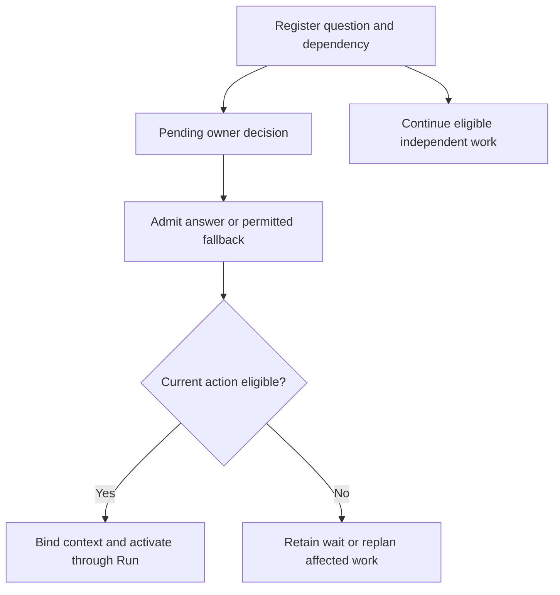

# Asynchronous Question Mechanism, 2026-11-22

## Scope and provenance

Research date: **2026-11-22**. This report develops the product owner's request for
asynchronous questions, optional answers with bounded autonomy, and required
answers that hold only affected work. Respondents may be humans, agents or
external services. The product owner will agree the eventual ADR separately.

The [shared study][shared-study] preserves industry evidence, counterexamples and
source pins. This report owns only the product-specific proposal and its open
choices. It inspected Orchestrator `a34587b313e656eeb43d755b4a4f08c40dff2116`,
Runtime `f990acc26e1b8071ae22d0b87a2ddd3672be8e2e`, their authority documents and
selected implementation. External source tests were inspected, not executed.
No new runtime, provider, performance or failure experiment was run.

**Implementation limit:** [ADR-0103][admission] currently admits Task creation and
metadata editing, plus a bounded Run activation and planned Work-placement sandbox. The broader
Work execution, dependency scheduling and continuation described here are not
implemented by that admission. The proposal therefore does not describe a small
patch to a fully available execution foundation or authorize building that
foundation as part of this documentation change.

## Findings and design options

### Proposed direction

Use a small, feature-owned durable clarification. An operation registers the
question and returns a registration receipt; a later operation admits the answer.
The affected action keeps its own preconditions. Work Coordination retains action
eligibility; Run retains authorized placement and continuation under its documented
boundaries. Required waiting survives the originating
provider turn, UI card and technical callback.

For the first bounded design, prefer one pending clarification per affected
continuation and a fallback selected when asking. Keep a separate request
aggregate and model-selected fallback as explicit alternatives below. These are
engineering recommendations for discussion, not accepted contracts or schemas.

### Semantic ownership and architecture

| The question changes | Existing semantic owner | Consequence |
| --- | --- | --- |
| Work requirements or action eligibility | Work Coordination | Admit the answer and guard the affected Work-owned action here. |
| A completion gate | Work and its Completion Evaluation | Reuse ADR-0072 where applicable; do not add a parallel question gate. |
| Run continuation or roster policy | Run Orchestration | Run owns the Run consequence, not every underlying requirement. |
| Permission for a protected action | Approval Management and applicable authority | A timeout or agent preference cannot manufacture approval. |
| Ordinary dialogue | Agent Communication | A message/reply relation need not become a Work dependency. |

[OD-026][od026] retains the strategic boundaries: Human Notification presents
owner facts; Attention expresses relevance and disruption intent; Context composes
admitted material; Run authorizes activation; Runtime applies technical input.
None becomes another decision ledger simply because it displays or routes a
question. A person, agent and service may share a delivery envelope while retaining
different identities, provenance and decision authority.

Apply Clean Architecture and SOLID concretely:

- **Domain:** the owning feature defines required evidence, permitted fallback,
  relevant basis and effective outcome. It imports no provider, workflow or UI SDK.
- **Application:** short commands authorize and commit transitions; a feature-owned
  process handles delivery, timer commands and reconciliation through narrow ports.
- **Adapters:** map provider interactions, authenticated service callbacks and
  client input into those commands. A workflow schedules commands, not domain rules.
- **DRY:** reuse existing receipts, canonical fingerprints, outbox, persistence,
  authorization and workflow adapters. Compare suitable libraries before adding a
  repeated technical mechanism. Extract shared technical code after concrete
  repeated use; do not merge advice, evidence and approvals into one domain model.

The [Runtime ACL boundary][runtime-acl] stays stateless. Any durable association
between a product request and a technical interaction belongs in the responsible
product process state. The [durable workflow adapter][workflow-boundary] does not
own Work eligibility. No new bounded context or general question service follows.

### Minimum information and state

The owning record needs a stable request identity and revision, owner scope,
affected continuation/action, relevant basis, eligible respondent rule, answer
shape, admitted policy reference, deadline semantics and effective outcome.
This is an information checklist for a concrete feature, not a universal schema.

Keep these identities distinct: product request/revision, logical reply command,
material Work/intent basis, Run authority generation, Runtime session generation
and interaction, and delivery correlation. An opaque provider token is not the
product request. Repeated wording is not evidence that two questions are identical.

A small candidate lifecycle is `pending`, `resolved`, `cancelled`, `superseded`.
A resolution records answer, authorized fallback or explicit refusal with its
origin. **Resolved does not mean the dependency is satisfied.** A refusal may close
the request while leaving the protected action ineligible. Required expiry can
trigger escalation or replanning while the request remains pending; it does not
create an answer, approval, Work failure or global Run pause automatically.

The material basis must name relevant requirements, constraints and policy
references. Using every new context message or the entire mutable Work revision
would invalidate answers after unrelated progress. A narrower basis requires an
explicit relevance rule; an LLM summary or prompt hash is not that rule. Current
authorization is checked again even when historical policy remains pinned.

### Candidate command and continuation flow

1. **Register.** An authorized owning command admits the clarification, its
   affected dependency and a recoverable delivery intent in one owning transaction.
   It commits before returning a registration receipt. Retries return the same
   logical request or a typed conflict for changed semantics.
2. **Continue.** Already eligible work may proceed within the goal, budget,
   permissions and resource ownership. The dependent action remains guarded by
   its owning precondition, even if the model calls registration and that action
   in parallel. Absence of a newly created question row is not permission to bypass
   evidence that the action already requires.
3. **Admit a response.** A separate command checks source identity, authority,
   request revision, answer shape, material applicability and deadline policy.
   A durable ingress receipt may precede this command; it must not be labelled an
   accepted semantic decision. Malformed or unauthorized input cannot win the race.
4. **Consider expiry.** A durable timer invokes an owning command with the expected
   request revision. It can select only an already authorized fallback that still
   applies. Required absence leaves the dependency unsatisfied. No model call or
   human wait runs inside the owning transaction. The command has a stable identity
   tied to the revision and admitted deadline/policy. Repeated delivery returns or
   reconciles its recorded outcome, including when the request remains pending;
   it does not repeat escalation merely because no resolution was committed.
5. **Commit one effective outcome.** Answer, fallback, cancellation and supersession
   compete through the owner's atomic transition. Retained receipts explain
   duplicates and losing commands. Resolution and delivery evidence stay distinct.
6. **Reconcile continuation.** An outbox fact advances the same stable continuation,
   with expected basis/context references. Context inclusion and Run activation
   follow [OD-033][od033]; actual effects still pass [OD-032][od032]. Recheck current
   eligibility, authority and cancellation at admission. A repeated wake reconciles
   that continuation rather than inventing another execution.

These are separate logical facts, not a requirement for a repository, service or
aggregate per step. Owner resolution, Context activation and Run execution are
not one cross-context transaction. Existing [eventing and reliability][eventing]
rules provide recoverable delivery; they do not turn an answered request into
exactly-once external effects.

### Honest tool and Runtime contracts

A product tool may return after durable registration **only if its declared
result is registration**. That result means the owner stored the request and
delivery intent; it does not mean the respondent saw it, answered it, or authorized
the dependent action. The model receives the later answer through an explicitly
supported input path with provenance preserved.

Do not substitute this receipt for a native question tool or asynchronous function
that promises the actual answer. Such calls keep their documented answer,
decline, cancellation or deferral behavior. Absence must not be fabricated as a
human refusal. A permission callback must not return allow just to keep reasoning
moving. Even a custom registration tool may need provider permission: qualify
that narrow path without globally bypassing approvals.

The inspected [Runtime owner][runtime-owner] permits an independent `reply`, but
only one active technical input through `dispatch`. Its result and restore paths
invalidate pending interactions; reply application can become uncertain.

A later product answer is not necessarily a Runtime interaction reply. If the
publication call completed and no genuine pending interaction exists, `reply` is
inapplicable. In the inspected baseline, normal queued input waits for an
admissible dispatch after predecessor/control barriers. Applying arbitrary input
during an active operation needs a separately qualified path; do not synthesize
a native pending interaction to route the answer.

| Situation | Candidate behavior within existing boundaries |
| --- | --- |
| Provider continues after product registration | Same worker can do eligible work; this capability needs qualification. |
| Native callback suspends its operation | Keep the true callback/deferral contract; other eligible executions may proceed. |
| Operation finishes while product decision remains pending | Keep the business wait; another operation needs the normal predecessor/control barriers. |
| Answer arrives after callback expiry or generation change | Admit against product state; reconcile or use a qualified new input path instead of replaying the old callback. |
| No useful eligible work remains | Persist the wait without a model polling loop or fabricated tasks. |

Provider turn completion is not Work completion. A required dependency must remain
visible to the owning execution/completion policy. Conversely, an advisory
question need not prevent completion if its admitted policy permits closure.

[ADR-0101][occupancy] does not release exclusive Agent occupancy on pause or
timeout. Another active Run cannot reuse that Agent merely because it is waiting.
Cheap durable waiting also does not prove a physical process stopped. Runtime
cannot checkpoint an active technical input in the inspected feature. Any resource
release or successor binding follows its existing custody rules.

### Storage alternatives and bounded estimates

**A. Bounded state inside the owning execution/intent.** Prefer this for a
one-question experiment when the question lifecycle is subordinate to that root.
Creation, cancellation and dependency checks are easier to make atomic. Keep only
bounded active state; use existing receipts/history for prior outcomes rather than
growing a transcript inside the aggregate. The tradeoff is contention between
answers and unrelated root edits, and an explicit cardinality limit.

**B. Separate request aggregate in the same semantic owner.** Prefer this when
several questions, independent revision/retention or measured contention are actual
first-version requirements. Creating the request and linking the dependency must
be atomic within the owning context's Unit of Work. Define lock/CAS order and
validate the exact resolution against current Work at dispatch admission; an
eventually updated `ready` projection is insufficient. Provider restart alone
does not justify another aggregate because the existing root is already durable.

[ADR-0072][completion] is a precedent for small authority plus evaluation state
and a delivery-only process manager. Its completion model should be reused for
actual completion questions, not expanded to every clarification.

The following estimates cover only an incremental clarification kernel **after**
owning persistence, receipts, authorization, outbox and an enforceable execution
precondition exist. These prerequisites are not all implemented by the current
admission. Scores are engineering judgments, not measurements or service levels.
Higher complexity is worse; higher confidence and expected reliability are better.

| Alternative | Confidence /10 | Complexity /10 | Expected reliability /10 in stated scope | Handwritten production TypeScript |
| --- | --- | --- | --- | --- |
| A: one bounded active clarification per continuation | 5 | 4 | 7 | 600–1,500 LOC |
| B: independently addressable same-owner aggregate | 5 | 6 | 7 | 900–2,100 LOC |

The inspected Runtime interaction owner/model/adapter and main helper/port files
total roughly 823 lines before remaining composition surfaces. That different
feature is only an order-of-magnitude analogy. The ranges exclude tests, UI,
responder integrations, production Host/provider qualification, Temporal
deployment and missing Work/Run foundations. They are **not the cost of delivering
the complete experience**. Another aggregate does not inherently raise reliability.
Re-estimate after selecting a concrete slice; no timeline is implied.

### Deadline and autonomy alternatives

| Choice | Simpler candidate | Alternative and its real cost |
| --- | --- | --- |
| Start of waiting window | Durable registration time; delivery delay consumes the window | Verified delivery/presentation needs a trustworthy channel-specific event; delivery is still not proof of reading. |
| Optional fallback cutoff | Owner admits a valid answer before the deadline in its atomic transition | Trusted durable ingress before deadline requires accounting for all timely candidates before committing fallback. A timestamp or arbitrary grace delay alone is insufficient. |
| Fallback | Record a permissible fallback when asking, then revalidate it on expiry | Model selection at expiry is additional work with budget, cancellation and answer-versus-selection races. The model returns a proposal for a fresh owner transition. |
| Required no-answer | Retain the unsatisfied dependency and consider escalation/replan | Reassignment, cancellation or eventual failure need explicit owning policy; no automatic approval. |

For optional fallback in an initial design, registration time plus owner admission is the smaller
candidate. It honestly promises a processing boundary, not “any client submission
before the displayed time wins.” Define that admission means validation and the
owner transition, not a queued candidate. If validation needs external work, this
simple policy may be unsuitable and must be revisited before promising the UX.

For a required answer, the initial deadline is an **escalation target**, not an
answer rejection boundary. A valid answer remains admissible afterward until
cancellation, supersession or an explicitly different admitted policy closes that
opportunity. Required waiting must not become impossible to resolve after a reminder.

If an optional fallback is no longer applicable or authorized at expiry, record
that unresolved expiry and use the owning escalation/replan/supersession path.
Retain the unsatisfied dependency with that explicit reason; do not falsely resolve
it or silently extend the deadline. Subsequent input can support a new guarded
decision. The owning process must retain the replanning obligation, rather than
leaving a pending request with no permitted next step.

Timers can arrive late. For an optional cutoff, the owner checks its authoritative
clock and recorded deadline in either command; a late timer does not extend the
window. The required escalation target has the different semantics above.
Retry, malformed input or reassignment does not reset it. Notification retries,
provider callback expiry, heartbeat and data retention have different clocks.

The semantic owner classifies required evidence; agents may propose a mode.
Policy and Risk constrains automation, while user preferences tune permitted
waiting and disruption. [RunPolicySnapshot][run-policy] retains Run consequences;
it is not a bag for every question setting. Active policy changes require explicit
revision/replan semantics at the relevant owner. Historic snapshots cannot retain
revoked authority. Precedence and user controls remain open below.

## Decision status and qualification

### Bounded first design exercise

Use one Work-owned clarification with one eligible respondent route and a known
affected action. Demonstrate an optional clarification with predeclared fallback
and a required clarification while **one already planned independent activity**
continues. Use explicit, separate input/output scopes. An agent's declaration or
missing graph edge does not prove semantic independence. Unrestricted tool access
cannot enforce an arbitrary semantic assumption through prompt wording alone.

For example, an illustrative export Work can validate records against an already
known input schema while asking which output format to produce. Final serialization
depends on that choice. The optional variant can name an authorized CSV fallback;
the required variant waits for the consumer's format contract. Input validation
qualifies as independent only if it does not itself depend on the disputed format.
If that activity finishes before the answer, preserve the remaining wait.

Before admitting implementation, identify which prerequisite owning execution and
dispatch precondition actually exists. Do not hide a general dependency scheduler
inside this feature. Select one real provider/client surface for continuation
qualification; synthetic tests can establish owner invariants but cannot prove
that provider keeps working. Do not build all human, agent and service integrations
to demonstrate the common provenance boundary.

The qualification record can stay small:

| Question about the chosen provider path | Evidence required |
| --- | --- |
| Which exact surface is used? | Version, configuration, root/child path, tool contract and its permission behavior. |
| Can this worker continue? | Observed independent progress, or explicit supported suspend/defer semantics. |
| Where does later input apply? | Turn/safe-point/session boundary and generation/correlation checks. |
| What does an acknowledgement prove? | Separate registration, queued delivery and confirmed context inclusion; none alone proves model understanding. |
| What survives failure? | Reconnect/restart behavior, stale callbacks, uncertain application and reconciliation. |

Unknown capability remains unknown. It cannot be converted into synthetic success.
Do not add a universal capability protocol, question broker, workflow per question,
new scheduler, speculative branch engine or global semantic dependency detector.
Separate workflow history/lifecycle needs may justify later extraction; merely
making the UI asynchronous does not.

### Discriminating cases for the later implementation

These are design examples for choosing a bounded slice, not a new mandatory test
framework or a claim that any scenario has been executed here.

| Case | Required distinction |
| --- | --- |
| Registration succeeds but delivery is delayed | Receipt is durable registration; deadline semantics say whether delivery delay consumes the window. |
| Registration races a dependent tool call | The existing required action precondition remains closed; ordering in the model transcript is insufficient. |
| Optional answer and fallback timer race | One owner outcome for the revision; each command checks the same defined cutoff. |
| Required answer arrives after escalation | It can still resolve the current request; the escalation target was not an answer cutoff. |
| Optional fallback becomes invalid before expiry | No default effect or false resolution; explicit owning replan/escalation and a defined path for subsequent input. |
| Timely ingress is processed after cutoff | Follow the selected policy; do not promise receipt fairness without complete receipt reconciliation. |
| Required request is refused or dismissed | Explicit refusal can close the request without satisfying the action; hiding a card is not that decision. |
| Provider completes or restarts before answer | Product waiting survives; old interaction/generation cannot be replayed as current authority. |
| Unrelated progress versus changed material requirements | Only the relevant basis determines whether the answer remains applicable. |
| Duplicate answer or repeated outbox wake | Retained command outcome and the same continuation identity; no blind repeat of effects. |
| Cancellation or authority revocation after answer | Fresh activation/dispatch admission rejects obsolete authority; delivered context is not a permit. |
| Late answer after fallback or scope completion | Record a typed late/superseded outcome; any replan is a new guarded decision, not retroactive history. |
| Several agents wait on each other or capacity is exhausted | Surface the actual dependency/resource cause; replan or park without false occupancy release. |

### Presentation and learning

Show the question, what depends on it, what continues, and what happens without an
answer. Distinguish an optional question from a required decision and silence from
explicit refusal. Keep the normal composer usable and preserve unfinished drafts;
deduplicate reminders and reconcile responses from another client. Display only
the application evidence available: “answer saved” can precede “passed to agent.”
Required waiting is projected from owner state, not the lifespan of a notification.

Candidate learning measures are useful independent progress, wait with no eligible
work, unnecessary question burden, fallback rework and stale/duplicate dispositions.
These are investigation measures, not new SLO thresholds. No numeric waiting
defaults, reminder cadence or autonomous-risk score is selected.

### Critical review corrections

Source challenge and independent owner, workflow and client reviews on 2026-11-22
narrowed the proposal in four material ways: planned Work placement is not actual
execution; a later product answer is not automatically a Runtime `reply`; a
required escalation target cannot reject all subsequent answers; and an invalid
optional fallback needs an explicit replanning path. Timer command receipts also
cover repeat escalation while a request remains pending. These are documentation
review results, not executed runtime qualification.

## Evidence and sources

The [shared source study][shared-study] records the industry comparison in detail:
Codex's distinct publication and answer paths; Claude's blocking and deferred
paths; connection-local steering; Temporal message/rollover constraints; Azure
buffering and its historical worker defect; AWS parallel joins; and the released
A2A specification's inconsistent blocking defaults. These are scoped evidence and
limitations, not provider qualification or reasons to add another engine.

Authority references below are local governed documents. Runtime source is pinned.
Accepted ADRs remain unchanged; this report adds research under open decisions.

## Limitations and remaining questions

The eventual ADR should settle a small set of coupled choices:

1. **Scope and owner:** which first action requires the answer, and which existing
   Work/Run prerequisites are available? Does the one-question limit suffice?
2. **Storage:** bounded entity or independent same-owner aggregate, with an exact
   consistency boundary and no competing readiness ledger?
3. **Time:** window start, clock/admission cutoff and what the UI may promise under
   processing and delivery delay?
4. **Autonomy:** required versus optional classification, predeclared versus
   dynamically chosen fallback, preference precedence and allowed user controls?
5. **Change and refusal:** active policy revisions, cancellation, reassignment,
   stale/late answers and when a new plan is warranted?
6. **Execution evidence:** the selected provider path, honest suspension fallback,
   current-context activation and effect admission/reconciliation?

The working preference is A, predeclared fallback, registration-time window and
owner-admission cutoff for a deliberately bounded first experiment. If the product
requires multiple independently pending questions or a guaranteed pre-cutoff
submission window, reconsider those choices before implementation. There is no
accepted ADR, public API or production implementation commitment here.

[shared-study]: https://github.com/agent-teams-ai/engineering-research/blob/365a57621f3fd68cdb277f89999f0ba4336a5736/docs/studies/asynchronous-questions-and-independent-progress-2026-11-21.md#follow-up-evidence--2026-11-22
[admission]: ../decisions/0103-first-sandbox-runtime-migration-slice-admission.md
[od026]: ../open-decisions/OD-026-communication-notification-and-attention.md
[od032]: ../open-decisions/OD-032-last-mile-side-effect-safety.md
[od033]: ../open-decisions/OD-033-ooda-convergence-and-context-activation.md
[runtime-acl]: ../decisions/0079-runtime-authority-binding-cutoff-and-disposition.md
[workflow-boundary]: ../decisions/0027-temporal-as-run-orchestration-adapter.md
[eventing]: ../architecture/eventing-and-reliability.md
[completion]: ../decisions/0072-atomic-work-completion-evaluation.md
[run-policy]: ../decisions/0063-typed-run-resilience-policy-snapshot.md
[occupancy]: ../decisions/0101-run-specific-rosters-coordination-and-exclusive-agent-occupancy.md
[runtime-owner]: https://github.com/agent-teams-ai/agent-runtime/blob/f990acc26e1b8071ae22d0b87a2ddd3672be8e2e/packages/contexts/agent-execution/src/features/interactive-agent-session/application/use-cases/interactive-session-owner.ts
